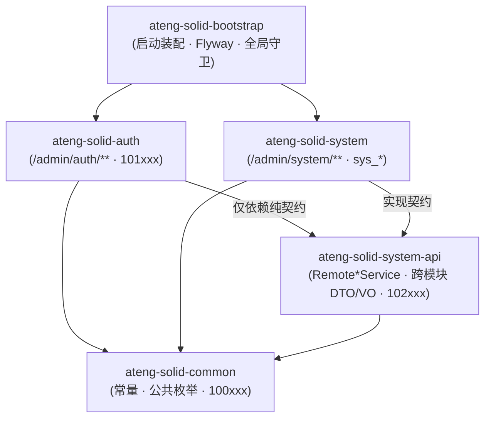

# Context Map: ateng-solid-server

`ateng-solid-server` 采用面向 `ateng-cloud` 平滑演进的多上下文（Multi-Context）5 模块单体架构。本映射表作为全仓库限界上下文边界与模块依赖流向的**唯一权威入口**。

---

## Contexts

- **[Common 公共基础底座](./ateng-solid-common/CONTEXT.md)**（`ateng-solid-common`）：全局常量、公共错误码（`100000~100999`）、基础通用枚举（`IBaseEnum`）、上下文辅助工具与跨端通用基础模型，零业务逻辑与持久层依赖。
- **[System API 系统域契约层](./ateng-solid-system-api/CONTEXT.md)**（`ateng-solid-system-api`）：系统管理域对外纯 Java 契约接口（`RemoteUserService`、`RemoteTenantService`、`RemotePermissionService`、`RemoteAuditLogService`）、跨模块 DTO/VO 与系统域错误码（`102000~102999`）；严禁引入 Web/MyBatis/Entity 依赖。
- **[System 系统管理域](./ateng-solid-system/CONTEXT.md)**（`ateng-solid-system`）：租户与套餐、用户、角色、菜单、部门、岗位、动态字典、系统参数与登录/操作日志的完整后端实现，挂载 `/admin/system/**` 接口并实现 `system-api` 契约。
- **[Auth 认证与会话中心](./ateng-solid-auth/CONTEXT.md)**（`ateng-solid-auth`）：管理端认证登录、图形验证码、防爆破锁定、密码校验、个人中心与在线会话强退（`/admin/auth/**`、`loginType="admin"`、`satoken-admin`），错误码段 `101000~101999`；只消费 `system-api` 与 `common`。
- **[Bootstrap 单体装配与迁移中心](./ateng-solid-bootstrap/CONTEXT.md)**（`ateng-solid-bootstrap`）：Spring Boot 主启动入口、全局配置文件（`application*.yml`）、Flyway 版本化数据库迁移脚本及全局拦截器/切面/ArchUnit 架构守卫集成点。

---

## Relationships

### 模块边界与演进铁律
1. **单向无环流**：禁止 `auth` 依赖 `system`；禁止 `system-api` 依赖 `system`、`Web` 或持久层 ORM。
2. **零跨模块 JOIN 与外键**：各服务域数据库表无物理外键，未来可整块拆分至 `ateng-cloud` 独立服务与独立数据库。
3. **事件异步解耦审计**：认证域产生的登录事件经领域事件/契约接口投递给系统域落库，Cloud 化后可直接切换为消息队列。

---

## Architectural Decisions

架构演进与关键技术选型索引见 **[架构决策记录看板 (docs/adr/README.md)](./docs/adr/README.md)**。
