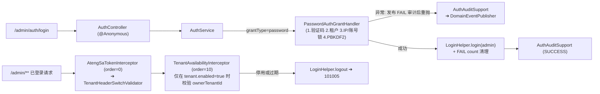

# ateng-solid-auth 管理端认证与会话治理模块

> 一句话定位：承担管理端认证中心、图形验证码、多维度防爆破锁定 `101004`、个人中心、不透明会话句柄强退与租户运行时可用性拦截（接口前缀 `/admin/auth/**`，错误码段 `101000~101999`）；零自建持久化表，通过 `ateng-solid-system-api` 契约与领域事件实现模块解耦。

---

## 0. 对外契约、安全引擎与端点全景速查 (`Spec 1 ~ Spec 2`)

| 能力域 | 产物 / 入口 | 核心端点 / SPI / 配置键 | 核心输入 / 输出与边界约定 | 锚定验证测试 (`*Test.java`) |
| :--- | :--- | :--- | :--- | :--- |
| 认证接口中心 | [`AuthController`](./src/main/java/io/github/atengk/solid/auth/controller/AuthController.java) · [`AuthService`](./src/main/java/io/github/atengk/solid/auth/service/AuthService.java) | `GET /admin/auth/captcha`<br/>`POST /admin/auth/login`<br/>`POST /admin/auth/logout`<br/>`GET /admin/auth/info`<br/>`GET /admin/auth/routes` | 验证码与登录标注 `@Anonymous` 与 `@RateLimiter`（按 `LimitType.IP` 各限 `30 次 / 60s`，收口 `solid:rate_limit:`）；登录兼容 `tenantCode` 与 `X-Tenant-Id`；签发 `satoken-admin` 令牌；`/info` 实时读取角色权限并返回 `passwordNeedsChange` | [`AuthFlowMockMvcTest`](../ateng-solid-bootstrap/src/test/java/io/github/atengk/solid/AuthFlowMockMvcTest.java)<br/>[`AuthSecurityEdgeMockMvcTest`](../ateng-solid-bootstrap/src/test/java/io/github/atengk/solid/AuthSecurityEdgeMockMvcTest.java)<br/>[`RateLimiterMockMvcTest`](../ateng-solid-bootstrap/src/test/java/io/github/atengk/solid/RateLimiterMockMvcTest.java) |
| 个人中心与改密 | [`ProfileController`](./src/main/java/io/github/atengk/solid/auth/controller/ProfileController.java) · [`ProfileService`](./src/main/java/io/github/atengk/solid/auth/service/ProfileService.java) | `GET /admin/auth/profile`<br/>`PUT /admin/auth/profile`<br/>`POST /admin/auth/profile/avatar`<br/>`PUT /admin/auth/password` | 全链路操作 `ownerTenantId` 归属租户；`/profile` 读真明文；`/avatar` 双重限流 `<=2MB` + 魔数守卫 `100004`；`/password` 标记 `@OperateLog(saveParams = false)` 且改密后踢出全端会话 | [`AuthFlowMockMvcTest`](../ateng-solid-bootstrap/src/test/java/io/github/atengk/solid/AuthFlowMockMvcTest.java)<br/>[`AuthSecurityEdgeMockMvcTest`](../ateng-solid-bootstrap/src/test/java/io/github/atengk/solid/AuthSecurityEdgeMockMvcTest.java) |
| 在线会话治理 | [`OnlineSessionController`](./src/main/java/io/github/atengk/solid/auth/controller/OnlineSessionController.java) · [`OnlineSessionService`](./src/main/java/io/github/atengk/solid/auth/service/OnlineSessionService.java) | `GET /admin/auth/online/page` (`auth:online:list`)<br/>`DELETE /admin/auth/online/{sessionId}` (`auth:online:kickout`) | 分页 `size` 上限 `100`；列表下发 `sessionId` 不透明句柄与 `tokenMask`，严禁下发原始 `tokenValue`；强退自身抛 `101007` | [`AuthFlowMockMvcTest`](../ateng-solid-bootstrap/src/test/java/io/github/atengk/solid/AuthFlowMockMvcTest.java)<br/>[`OpaqueSessionHandleCodecTest`](./src/test/java/io/github/atengk/solid/auth/security/OpaqueSessionHandleCodecTest.java) |
| 密码授权策略 | [`PasswordAuthGrantHandler`](./src/main/java/io/github/atengk/solid/auth/grant/PasswordAuthGrantHandler.java) | `AuthGrantHandler` (`grantType = "password"`) | 验证码（不扣重试次数）➔ 租户（不扣重试次数）➔ IP/账号锁前检 ➔ PBKDF2 防枚举 4 步串行链 | [`PasswordAuthGrantHandlerTest`](./src/test/java/io/github/atengk/solid/auth/grant/PasswordAuthGrantHandlerTest.java)<br/>[`AuthSecurityEdgeMockMvcTest`](../ateng-solid-bootstrap/src/test/java/io/github/atengk/solid/AuthSecurityEdgeMockMvcTest.java) |
| 防爆破 `101004` 透传 | [`LoginLockedException`](./src/main/java/io/github/atengk/solid/auth/security/LoginLockedException.java) · [`AuthExceptionCustomizer`](./src/main/java/io/github/atengk/solid/auth/security/AuthExceptionCustomizer.java) | `GlobalExceptionCustomizer`<br/>`ateng.boot.satoken.login-defense.*` | 将 IP / `ACCOUNT` 锁定扩展异常映射为 `Result<LoginLockDetailVO>`（`code = 101004`，含 `lockType` 与数值型 `remainSeconds`） | [`PasswordAuthGrantHandlerTest`](./src/test/java/io/github/atengk/solid/auth/grant/PasswordAuthGrantHandlerTest.java)<br/>[`AuthFlowMockMvcTest`](../ateng-solid-bootstrap/src/test/java/io/github/atengk/solid/AuthFlowMockMvcTest.java)<br/>[`AuthSecurityEdgeMockMvcTest`](../ateng-solid-bootstrap/src/test/java/io/github/atengk/solid/AuthSecurityEdgeMockMvcTest.java) |
| 不透明会话句柄 | [`OpaqueSessionHandleCodec`](./src/main/java/io/github/atengk/solid/auth/security/OpaqueSessionHandleCodec.java) | `ateng.solid.auth.session-handle-secret` | AES-256-GCM 签密（SHA-256 定长派生），绑定 `loginType:tenantId` AAD 阻断跨租户重放；配置留空生成进程内随机临时密钥并输出告警日志 | [`OpaqueSessionHandleCodecTest`](./src/test/java/io/github/atengk/solid/auth/security/OpaqueSessionHandleCodecTest.java) |
| 租户解析与运行时拦截 | [`TenantResolutionSupport`](./src/main/java/io/github/atengk/solid/auth/service/TenantResolutionSupport.java) · [`TenantAvailabilityInterceptor`](./src/main/java/io/github/atengk/solid/auth/security/TenantAvailabilityInterceptor.java) · [`AuthWebMvcConfigurer`](./src/main/java/io/github/atengk/solid/auth/security/AuthWebMvcConfigurer.java) | `ateng.solid.tenant.enabled = true`<br/>`order = 10`（拦截 `/admin/**`） | 仅多租户开启时装配，排除 `/admin/auth/{captcha,login,logout}`；平台租户 `"0"` 豁免；普通租户失效立即注销会话并抛 `101005` | [`TenantRuntimeGuardMockMvcTest`](../ateng-solid-bootstrap/src/test/java/io/github/atengk/solid/TenantRuntimeGuardMockMvcTest.java) |
| 登录审计、配置与错误码 | [`AuthAuditSupport`](./src/main/java/io/github/atengk/solid/auth/service/AuthAuditSupport.java) · [`SolidAuthProperties`](./src/main/java/io/github/atengk/solid/auth/properties/SolidAuthProperties.java) · [`AuthResultCode`](./src/main/java/io/github/atengk/solid/auth/result/AuthResultCode.java) | `ateng.solid.auth.*`<br/>`AuthResultCode` (`101001`–`101007`) | 成功/失败/注销全链路异步发布 `LoginAuditEvent`；失败审计异常内部告警吸收，绝不掩盖原始认证异常 | [`ConfigurationBaselineIntegrationTest`](../ateng-solid-bootstrap/src/test/java/io/github/atengk/solid/ConfigurationBaselineIntegrationTest.java)<br/>[`ResultCodeSegmentTest`](../ateng-solid-bootstrap/src/test/java/io/github/atengk/solid/ResultCodeSegmentTest.java) |

---

## 1. 模块定位与依赖边界

- **绝对模块隔离**：仅依赖 `ateng-solid-common` 与 `ateng-solid-system-api`，严禁依赖 `ateng-solid-system` 与任何持久层 Mapper / 数据库表（由 `ArchitectureGuardTest` 规则 1 守卫）。
- **接入层与服务边界**：全模块强制构造器注入（`@RequiredArgsConstructor`），严禁 `@Autowired` 字段注入与 `@Value`/`@RefreshScope`；Controller 统一返回 `Result<T>` 或 `PageResult<VO>` 包装（数值字段如 `expireSeconds`/`expireIn`/`remainSeconds`/`tokenTimeout` 显式保留 JSON `number` 语义），Service 层禁止直接依赖 `jakarta.servlet.*`。

---

## 2. 认证流水线与双层租户守卫架构



---

## 3. 核心能力实现（配置 · 调用 · 边界闭环）

### 3.1 管理端认证中心与防爆破 `101004` 透传

1. **配置基线（提取自已验证 `application.yml`）**：

```yaml
ateng:
  boot:
    satoken:
      primary-login-type: admin
      super-admin-roles: [super_admin]
      login-defense:
        enabled: true
      interceptor:
        enabled: true
        check-login: true
        login-type-routes:
          admin: [/admin/**]
  solid:
    auth:
      captcha-enabled: true
      session-handle-secret: ${SOLID_AUTH_SESSION_HANDLE_SECRET:YOUR_SESSION_HANDLE_SECRET}
```

2. **核验与透传流（`PasswordAuthGrantHandler` + `AuthExceptionCustomizer`）**：
   - `GET /admin/auth/captcha` 在 `captcha-enabled=false` 时直接返回 `enabled=false` 占位载荷而不触碰 `CaptchaTemplate`；开启时生成一次一密图形验证码；
   - `POST /admin/auth/login` 按“一次一密 `CaptchaTemplate.verify`（`101001`）➔ `TenantResolutionSupport` 校验可用租户（`101005`）➔ `LoginFailureLockService` IP 熔断 / 租户作用域账号锁定检查（`LoginLockedException`）➔ 显式租户定界查询 + `PasswordUtil.matches` 统一失败计数防账号枚举”执行，停用账号在密码核验通过后返回 `101003`；
   - `AuthExceptionCustomizer` 拦截 `LoginLockedException`，向前端透传 `Result<LoginLockDetailVO>`（`code=101004`，`data={lockType: "IP"|"ACCOUNT", remainSeconds}`）。
3. **关键边界**：
   - 验证码错误（`101001`）与租户不可用（`101005`）均**绝不计入** `LoginFailureLockService` 密码失败次数，防止恶意利用不存在租户或空验证码触发 IP 误封；
   - `AuthService.issueAdminSession` 将 `roles` 写入 `LoginUser` 供 `@SaCheckRole`/`isSuperAdmin` 快速判定，而 `/admin/auth/info` 通过 `StpLogic.getRoleList()` 与 `getPermissionList()` 实时读取 `CachedStpInterface` 生效缓存，使平台超管 `X-Tenant-Id` 切换与普通权限变更即时生效。

### 3.2 不透明会话句柄签密与在线会话治理

1. **无状态签密（`OpaqueSessionHandleCodec`）**：
   - 使用配置密钥 `ateng.solid.auth.session-handle-secret` 经 SHA-256 派生定长 32 字节 AES-256-GCM 密钥（未配置时生成进程内随机临时密钥并打印告警），每次签密随机生成 12 字节 IV，并以 `loginType:tenantId` 作为 GCM AAD 关联认证数据输出无填充 Base64URL `sessionId`。
2. **分页筛选与强退流（`OnlineSessionService`）**：
   - `GET /admin/auth/online/page` 需 `auth:online:list` 权限，基于 `AuthContextSupport.resolveEffectiveTenantIdString()` 限定工作租户并限制每页上限 `MAX_PAGE_SIZE = 100`，列表项仅暴露 `sessionId`（不透明句柄）、`tokenMask`（前后保留明文、中间脱敏为 `****`）与 `currentSession` 标记；
   - `DELETE /admin/auth/online/{sessionId}` 需 `auth:online:kickout` 权限，先校验 `sessionId` 解密与 AAD 绑定（失败统一抛 `400`），再比对当前令牌阻断强退自身（`101007`），最后调用 `LoginHelper.kickoutByTokenForTenant` 执行防跨租户强退。

### 3.3 租户运行时可用性拦截与个人中心/改密边界

1. **双层租户运行时防线（`TenantAvailabilityInterceptor`）**：
   - 通过 `AuthWebMvcConfigurer` 在 `ateng.solid.tenant.enabled=true` 时注册于 `order = 10`（晚于 Sa-Token 鉴权拦截器 `order = 0`），拦截 `/admin/**` 并放行 `/admin/auth/{captcha,login,logout}`；
   - 检查已登录用户的**归属租户 `ownerTenantId`**（平台租户 `"0"` 放行），一旦发现归属租户被停用或自然过期，立即调用 `LoginHelper.logout("admin")` 并抛出 `101005`。
2. **个人中心与零明文改密（`ProfileService`）**：
   - `/profile` 与 `/profile/avatar` 始终锁定会话归属租户 `ownerTenantId`，即使平台超管通过 `X-Tenant-Id` 切入其他工作租户视角查看业务数据时，个人中心仍稳定读写超管本人档案；
   - `PUT /admin/auth/password` 控制器声明 `@OperateLog(..., saveParams = false)` 脱敏审计请求参数；服务内先后校验旧密码（`101006`）、`PasswordPolicyValidator.validate`（`100001`）并在认证域本地完成 `PasswordUtil.hash` 慢哈希计算，仅将摘要通过 `RemoteUserService.updatePasswordHash` 落库，随后通过 `LoginHelper.logoutByLoginType` 强退该用户全部在线 `admin` 会话。

---

## 4. 非功能基线与测试覆盖

- **离线可测与 0-Leak 保障**：单测（`PasswordAuthGrantHandlerTest`、`OpaqueSessionHandleCodecTest`）与全容器 MockMvc 集成测试（`AuthFlowMockMvcTest`、`AuthSecurityEdgeMockMvcTest`、`TenantRuntimeGuardMockMvcTest`、`RateLimiterMockMvcTest`）依托 H2 + 内存 Captcha/Lock/RateLimiter/Token 存储与 `MockStorageConfig` 100% 离线自洽；`ArchitectureGuardTest` 确保 `ateng-solid-auth` 与 `ateng-solid-system` 实现类零耦合。

---

## 5. 错误码附录（`101000~101999`）与关联文档

| 枚举常量 | 错误码 | 默认提示文案 |
| :--- | :---: | :--- |
| `CAPTCHA_INVALID` | `101001` | 图形验证码无效或已过期，请重新输入 |
| `BAD_CREDENTIALS` | `101002` | 用户名或密码错误 |
| `ACCOUNT_DISABLED` | `101003` | 账号已被停用，请联系管理员处理 |
| `LOGIN_LOCKED` | `101004` | 连续登录失败次数过多，请稍后重试 |
| `TENANT_UNAVAILABLE` | `101005` | 所属租户不存在、已停用或已过期，请联系平台管理员 |
| `OLD_PASSWORD_MISMATCH` | `101006` | 当前密码输入有误，请核对后重试 |
| `CANNOT_KICKOUT_SELF` | `101007` | 当前会话正在使用中，不可强退自身会话 |

- 领域词汇表：[`CONTEXT.md`](./CONTEXT.md)
- 认证与权限规范：[auth-rbac-and-datascope-spec.md](../docs/specs/auth-rbac-and-datascope-spec.md)
- 接口契约与错误码规范：[api-and-error-codes-spec.md](../docs/specs/api-and-error-codes-spec.md)
- 架构配置规范：[configuration-and-archunit-spec.md](../docs/specs/configuration-and-archunit-spec.md)
