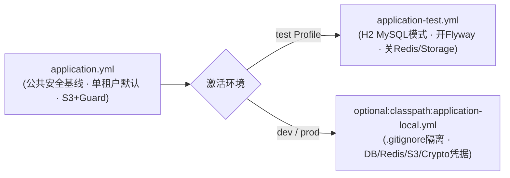

# ateng-solid-bootstrap 单体聚合宿主与双模基线模块

> 一句话定位：`ateng-solid-server` 单体运行装配入口，聚合 `auth` 与 `system` 模块并承载 `application*.yml` 双模外部化配置基线、运行时驱动及 9 条 ArchUnit 架构硬守卫。

---

## 0. 对外契约与能力全景速查矩阵

| 能力域 | 产物 / 入口 | 关键机制 / 配置段 | 运行要求与安全守卫 | 锚定验证测试 (`*Test.java`) |
| :--- | :--- | :--- | :--- | :--- |
| 启动宿主 | [`SolidApplication`](./src/main/java/io/github/atengk/solid/SolidApplication.java) | `@SpringBootApplication` + `@ConfigurationPropertiesScan("io.github.atengk.solid")` | 自动装配 `SolidTenantProperties` / `SolidAuthProperties` / `SolidSystemProperties` | [`ConfigurationBaselineIntegrationTest`](./src/test/java/io/github/atengk/solid/ConfigurationBaselineIntegrationTest.java) |
| 运行依赖 | [`pom.xml`](./pom.xml) | `mysql-connector-j`、`flyway-mysql`、`aws-sdk:{s3,apache-client}`（`runtime`） | 离线 `test` Profile 使用 H2 内存库（启用 Flyway 并关闭 Redis/Storage） | `mvn clean test -B -T 1C -nsu` |
| 主配置基线 | [`application.yml`](./src/main/resources/application.yml) | Java 21 虚拟线程、`satoken` 多账号路由、数据权限、S3+Guard、异步密码池、`ateng.solid.*` | 默启单租户；`password-hash` 使用 `platform` 线程池；数据权限失败 `DENY_ALL` | [`ConfigurationBaselineIntegrationTest`](./src/test/java/io/github/atengk/solid/ConfigurationBaselineIntegrationTest.java) |
| 本地模板 | [`application-local.example.yml`](./src/main/resources/application-local.example.yml) | MySQL 8.4 LTS、Redis 8.x、S3 Path-Style、加密密钥与会话句柄密钥占位符 | 真实 `application-local.yml` 已被 `.gitignore` 忽略，模板禁含明文凭据 | 人工/Pre-commit 门禁 |
| 离线测试桩 | [`application-test.yml`](./src/main/resources/application-test.yml) | H2 `MODE=MySQL`、`flyway.enabled: true`、排除 Redis 自动装配与 `redis/storage.enabled: false` | 为离线单测/集成测试激活 Flyway 全库迁移、切换 Captcha 内存存储并注入测试密钥与超管测试桩口令 | [`ConfigurationBaselineIntegrationTest`](./src/test/java/io/github/atengk/solid/ConfigurationBaselineIntegrationTest.java) · [`FlywaySchemaAndSeedIntegrationTest`](./src/test/java/io/github/atengk/solid/FlywaySchemaAndSeedIntegrationTest.java) |
| 认证与租户守卫 MockMvc | [`AuthFlowMockMvcTest`](./src/test/java/io/github/atengk/solid/AuthFlowMockMvcTest.java) · [`AuthSecurityEdgeMockMvcTest`](./src/test/java/io/github/atengk/solid/AuthSecurityEdgeMockMvcTest.java) · [`TenantRuntimeGuardMockMvcTest`](./src/test/java/io/github/atengk/solid/TenantRuntimeGuardMockMvcTest.java) | 登录路由闭环、一次一密、`101004` 防爆破、不透明句柄强退、`101005` 运行时阻断 | 端到端校验 `/admin/auth/**` 11 端点、IP/账号锁定详情、超管切租户、个人中心 `102002` 冲突与头像魔数 `100004` | [`AuthFlowMockMvcTest`](./src/test/java/io/github/atengk/solid/AuthFlowMockMvcTest.java) · [`AuthSecurityEdgeMockMvcTest`](./src/test/java/io/github/atengk/solid/AuthSecurityEdgeMockMvcTest.java) · [`TenantRuntimeGuardMockMvcTest`](./src/test/java/io/github/atengk/solid/TenantRuntimeGuardMockMvcTest.java) |
| 持久层加密与迁移验证 | [`FlywaySchemaAndSeedIntegrationTest`](./src/test/java/io/github/atengk/solid/FlywaySchemaAndSeedIntegrationTest.java) · [`ContactFieldEncryptPersistenceTest`](./src/test/java/io/github/atengk/solid/ContactFieldEncryptPersistenceTest.java) | 17 表迁移、58 条菜单种子与 SIV 加密往返 | 校验 17 张表与确定性种子落库、`"v1:..."` 密文写入（含 64 位邮箱）、ORM 解密、多 `NULL` 放行与软删重建 | [`FlywaySchemaAndSeedIntegrationTest`](./src/test/java/io/github/atengk/solid/FlywaySchemaAndSeedIntegrationTest.java) · [`ContactFieldEncryptPersistenceTest`](./src/test/java/io/github/atengk/solid/ContactFieldEncryptPersistenceTest.java) |
| 架构守卫 | [`ArchitectureGuardTest`](./src/test/java/io/github/atengk/solid/ArchitectureGuardTest.java) | 9 条 ArchUnit 硬红线 | 阻断跨模块越权、Web/ORM 污染、字段注入、`@Value`/`@RefreshScope` 与 `Result` 契约污染 | [`ArchitectureGuardTest`](./src/test/java/io/github/atengk/solid/ArchitectureGuardTest.java) |
| 错误码防碰撞 | [`ResultCodeSegmentTest`](./src/test/java/io/github/atengk/solid/ResultCodeSegmentTest.java) | 千位号段校验 + 类路径 `IResultCode` 全扫描 | 校验 `100xxx`/`101xxx`/`102xxx` 无越界且与底座全部错误码零重复 | [`ResultCodeSegmentTest`](./src/test/java/io/github/atengk/solid/ResultCodeSegmentTest.java) |

---

## 1. 模块定位与本地启动

- **严禁业务侵入**：本模块严禁编写业务 `@RestController`、`@Controller`、`@Service` 或 `*Mapper`，也不私藏业务域 Flyway 脚本（均由 `ArchitectureGuardTest` 规则 5 守卫）。
- **本地开发启动准备**：将 [`application-local.example.yml`](./src/main/resources/application-local.example.yml) 复制为同目录受忽略的 `application-local.yml`，填入本机 MySQL 8.4、Redis 8.x、S3/RustFS 与加解密密钥占位值即可启动。

```bash
mvn clean test -B -T 1C -nsu
```

---

## 2. 双模配置与安全加载架构



---

## 3. 核心基线配置与 9 条架构守卫

### 3.1 `ateng-boot` 安全基线与 `password-hash` 专属线程池（`application.yml`）

1. **核心配置段（提取自已验证 `application.yml`）**：

```yaml
ateng:
  boot:
    async:
      pools:
        password-hash:
          mode: platform
          core-pool-size: 4
          max-pool-size: 6
          queue-capacity: 64
    satoken:
      primary-login-type: admin
      super-admin-roles:
        - super_admin
      permission-cache:
        tenant-scoped: true
      tenant:
        header-name: X-Tenant-Id
        allow-anonymous-header: false
        allow-super-admin-switch: true
        platform-tenant-ids:
          - "0"
    mybatis-plus:
      data-permission:
        enabled: true
        failure-strategy: DENY_ALL
```

2. **配置属性与底座绑定**：`ateng.boot.async.pools.password-hash` 强制使用 `platform` 平台线程池，避免 PBKDF2 高 CPU 运算钉死 Java 21 虚拟线程载体；`ateng.boot.satoken.super-admin-roles` 仅包含 `super_admin`，防止将普通租户内置 `admin` 误判为全平台超管。
3. **边界防御**：`mybatis-plus.data-permission.failure-strategy` 锁定为 `DENY_ALL`，数据权限解析异常默认拒访保护敏感租户数据；`storage.guard` 强制开启扩展名白名单、严格魔数校验与 `2MB` 单图上限，同时锁定 `local.upload-endpoint-enabled: false`。

### 3.2 9 条 ArchUnit 架构红线（`ArchitectureGuardTest`）

| 序号 | 守卫方法 | 强制拦截红线 |
| :---: | :--- | :--- |
| 1 | `authMustNotDependOnSystemImplementation` | `auth` 禁止依赖 `system` 除 `system.api` 外的全部实现包 |
| 2 | `systemApiMustRemainFrameworkPure` | `system-api` 禁止引入 Web、MyBatis-Plus、Redis、Feign、Dubbo 或 Servlet |
| 3 | `noFieldInjectionAllowed` | 全局禁止 `@Autowired` / `@Resource` 字段注入 |
| 4 | `controllersMustNotLeakEntities` | Controller 公开方法出入参（含泛型）禁止暴露 `.entity` 包实体 |
| 5 | `bootstrapMustNotContainBusinessControllersOrMappers` | `bootstrap` 根包及子包禁止出现 Controller 与 `*Mapper` |
| 6 | `serviceMustNotDependOnServlet` | Service 层禁止依赖 `jakarta.servlet..` |
| 7 | `mapperMustNotDependOnControllerOrService` | Mapper 持久层禁止反向依赖 Controller 或 Service |
| 8 | `systemApiMustNotExposeResultWrapper` | `system-api` 方法签名、泛型及字段严禁引用 `` `Result<T>` `` |
| 9 | `noValueOrRefreshScopeAllowed` | 全局禁止使用 Spring `@Value` 与 `@RefreshScope`（强类型收口 `@ConfigurationProperties`） |

---

## 4. 非功能基线与待关注上游约束

- **离线可测性**：`test` Profile 已激活 `spring.flyway.enabled: true`，每次离线测试在 H2（`MODE=MySQL;DATABASE_TO_LOWER=TRUE`）自动执行 `V1.0.0`（17 张表）与 `V1.0.1`（58 条菜单及基础元数据种子）并完成 `ContactFieldCrypto` 确定性加密持久化验证。
- **底座枚举字典扫描提示**：当前 `EnumDictionaryRegistry` 已扫描注册全部 `6` 个业务实现 `IBaseEnum` 的枚举（`commonStatus`、`logStatus`、`configType`、`dataScopeType`、`menuType`、`visibleStatus`）；`ateng-boot` 的 `OperateTypeEnum`（`io.github.atengk.boot.core.audit`）尚未实现 `IBaseEnum`，将在后续操作审计工单对接时按 [foundation-first-gate.md](../docs/agents/foundation-first-gate.md) 推进上游增强。

---

## 5. 完整业务配置项字典（`ateng.solid.*`）

| 配置键前缀 | 配置字段 | 默认值（`application.yml`） | 归属配置类（模块） |
| :--- | :--- | :--- | :--- |
| `ateng.solid.tenant` | `enabled` / `status-cache-ttl` | `false` / `60s` | `SolidTenantProperties`（`common`） |
| `ateng.solid.auth` | `captcha-enabled` / `session-handle-secret` | `true` / `""` | `SolidAuthProperties`（`auth`） |
| `ateng.solid.init` | `enabled` / `super-admin-username` / `super-admin-nickname` / `super-admin-password` | `true` / `"superadmin"` / `"超级管理员"` / `""` | `SolidSystemProperties.InitProperties`（`system`） |
| `ateng.solid.data-scope` | `max-dept-in-size` | `1000` | `SolidSystemProperties.DataScopeProperties`（`system`） |
| `ateng.solid.user` | `import-max-rows` / `max-concurrent-imports` / `import-feedback-ttl` | `500` / `2` / `15m` | `SolidSystemProperties.UserProperties`（`system`） |
| `ateng.solid.cache` | `dict-ttl` / `config-ttl` | `30m` / `30m` | `SolidSystemProperties.CacheProperties`（`system`） |
