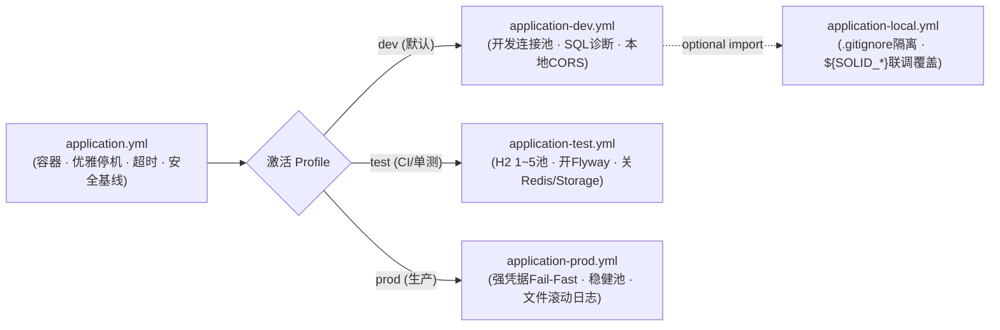

# ateng-solid-bootstrap 单体聚合宿主与双模基线模块

> 一句话定位：`ateng-solid-server` 单体运行装配入口，聚合 `auth` 与 `system` 模块并承载 `application*.yml` 双模外部化配置基线、运行时驱动及 9 条 ArchUnit 架构硬守卫。

---

## 0. 对外契约与能力全景速查矩阵

| 能力域 | 产物 / 入口 | 关键机制 / 配置段 | 运行要求与安全守卫 | 锚定验证测试 (`*Test.java`) |
| :--- | :--- | :--- | :--- | :--- |
| 启动宿主 | [`SolidApplication`](./src/main/java/io/github/atengk/solid/SolidApplication.java) | `@SpringBootApplication` + `@ConfigurationPropertiesScan("io.github.atengk.solid")` | 自动装配 `SolidTenantProperties` / `SolidAuthProperties` / `SolidSystemProperties` | [`ConfigurationBaselineIntegrationTest`](./src/test/java/io/github/atengk/solid/ConfigurationBaselineIntegrationTest.java) |
| 运行依赖 | [`pom.xml`](./pom.xml) | `ateng-boot-flyway`、`commons-pool2`、`mysql-connector-j`、`flyway-mysql`、`aws-sdk:{s3,apache-client}` | `commons-pool2` 由 Spring Boot BOM 统管以激活 Lettuce 池；离线 `test` 排除 Redis 自动装配并切换 H2 | `mvn clean test -B -T 1C -nsu` |
| 主配置基线 | [`application.yml`](./src/main/resources/application.yml) | Tomcat 队列/压缩、`shutdown: graceful`、Java 21 虚拟线程、Hikari/Redis 超时与保活、`logging.charset` (UTF-8)、`satoken`、`data-permission`、`S3+Guard`、`password-hash` 池、`ateng.solid.*` | 默认激活 `dev`；关冗余 `/pre-stop` MVC 端点仅留 `SmartLifecycle`；安全头 + `DENY_ALL` + `solid:` 键前缀 | [`ConfigurationBaselineIntegrationTest`](./src/test/java/io/github/atengk/solid/ConfigurationBaselineIntegrationTest.java) |
| 开发联调配置 | [`application-dev.yml`](./src/main/resources/application-dev.yml) | 导入 `optional:classpath:application-local.yml`、Hikari (`2~10` + 10s 泄漏检测)、Lettuce (`2~8`)、Redisson (`4/4/16/4`)、SQL 诊断、`localhost` CORS | 仅在 `dev` 下导入本机覆盖文件；`active-timeout: 2h`、`payload-log: false`、`DEBUG` 级业务日志 | 本地启动联调 / 单测验证 |
| 生产基线配置 | [`application-prod.yml`](./src/main/resources/application-prod.yml) | 强凭据零默认值 `${SOLID_*}` Fail-Fast、`flyway: ${SOLID_FLYWAY_ENABLED:false}`、Hikari (`5~20`)、Lettuce (`4~16`)、Redisson (`8~32`)、双文件滚动日志 | 禁 OpenAPI/Knife4j/H2Console、`sql-log`/`payload-log` 与通配跨域，仅留脱敏 `slow-sql`（异步）/慢请求与 `login-defense` | [ADR-0005](../docs/adr/0005-multi-env-configuration-and-pool-baseline.md) |
| 本地模板 | [`application-local.example.yml`](./src/main/resources/application-local.example.yml) | MySQL 8.4 LTS、Redis 8.x、S3 Path-Style、连接池覆写占位与加密/会话密钥 `${SOLID_*}` 占位符 | 真实 `application-local.yml` 已被 `.gitignore` 忽略，模板禁含明文凭据 | 人工 / Pre-commit 门禁 |
| 离线测试桩 | [`application-test.yml`](./src/main/resources/application-test.yml) | H2 `MODE=MySQL`、Hikari (`1~5`)、`flyway.enabled: true`、排除 Redis 自动装配、`web.shutdown` 快速关闭与测试桩密钥 | 100% 脱离 `application-local.yml` 与外部中间件自洽跑通全量测试 | [`ConfigurationBaselineIntegrationTest`](./src/test/java/io/github/atengk/solid/ConfigurationBaselineIntegrationTest.java) · [`FlywaySchemaAndSeedIntegrationTest`](./src/test/java/io/github/atengk/solid/FlywaySchemaAndSeedIntegrationTest.java) |
| 认证与租户守卫 MockMvc | [`AuthFlowMockMvcTest`](./src/test/java/io/github/atengk/solid/AuthFlowMockMvcTest.java) · [`AuthSecurityEdgeMockMvcTest`](./src/test/java/io/github/atengk/solid/AuthSecurityEdgeMockMvcTest.java) · [`TenantRuntimeGuardMockMvcTest`](./src/test/java/io/github/atengk/solid/TenantRuntimeGuardMockMvcTest.java) | 登录路由闭环、一次一密、`101004` 防爆破、不透明句柄强退、`101005` 运行时阻断 | 端到端校验 `/admin/auth/**` 11 端点、IP/账号锁定详情、超管切租户、个人中心 `102002` 冲突与头像魔数 `100004` | [`AuthFlowMockMvcTest`](./src/test/java/io/github/atengk/solid/AuthFlowMockMvcTest.java) · [`AuthSecurityEdgeMockMvcTest`](./src/test/java/io/github/atengk/solid/AuthSecurityEdgeMockMvcTest.java) · [`TenantRuntimeGuardMockMvcTest`](./src/test/java/io/github/atengk/solid/TenantRuntimeGuardMockMvcTest.java) |
| 5 级 `@DataScope` 真实 SQL 验证 | [`DataScopeH2SqlIntegrationTest`](./src/test/java/io/github/atengk/solid/DataScopeH2SqlIntegrationTest.java) · `DataScopeVerifyMapper` | H2 `AtengDataPermissionInnerInterceptor` + `SolidDataPermissionHandler` | 真实 SQL 验证 5 级策略、`DEPT+SELF` 括号防穿透、`create_by` 字符串分支、空角色/停用角色/无部门 `1=0` 与超限 `100003` 透传 | [`DataScopeH2SqlIntegrationTest`](./src/test/java/io/github/atengk/solid/DataScopeH2SqlIntegrationTest.java) |
| 组织架构与 RBAC 集成/HTTP 闭环 | [`OrgAndRbacIntegrationTest`](./src/test/java/io/github/atengk/solid/OrgAndRbacIntegrationTest.java) · [`OrgAndRbacEdgeIntegrationTest`](./src/test/java/io/github/atengk/solid/OrgAndRbacEdgeIntegrationTest.java) · [`OrgAndRbacMockMvcTest`](./src/test/java/io/github/atengk/solid/OrgAndRbacMockMvcTest.java) | `/admin/system/{dept,post,menu,role}/**`、事务后置缓存清理与 MockMvc 鉴权 | 验证部门 `ancestors` 批量重算与脱敏 `/options`、岗位唯一与引用防删、菜单仅平台 `0`、半选套餐兼容、保留词 `102004`/内置 `102007`/越界 `102006` 与 3 参 `clearRoleCache` | [`OrgAndRbacIntegrationTest`](./src/test/java/io/github/atengk/solid/OrgAndRbacIntegrationTest.java) · [`OrgAndRbacEdgeIntegrationTest`](./src/test/java/io/github/atengk/solid/OrgAndRbacEdgeIntegrationTest.java) · [`OrgAndRbacMockMvcTest`](./src/test/java/io/github/atengk/solid/OrgAndRbacMockMvcTest.java) |
| 用户 CRUD、配额行锁与 500 行导入导出 | [`SysUserCrudAndDataScopeTest`](./src/test/java/io/github/atengk/solid/SysUserCrudAndDataScopeTest.java) · [`SysUserExcelImportIntegrationTest`](./src/test/java/io/github/atengk/solid/SysUserExcelImportIntegrationTest.java) | `/admin/system/user/**`、5 级 `@DataScope`、悲观行锁防超卖、三段式导入与流式脱敏导出 | 验证用户 5 级读写隔离、并发配额不超卖、内置超管/自身保护 `102007`、9 列模板与 `Semaphore` 并发哈希及 `403/404` 批注隔离下载 | [`SysUserCrudAndDataScopeTest`](./src/test/java/io/github/atengk/solid/SysUserCrudAndDataScopeTest.java) · [`SysUserExcelImportIntegrationTest`](./src/test/java/io/github/atengk/solid/SysUserExcelImportIntegrationTest.java) |
| 多租户初始化与套餐裁剪闭环 | [`TenantAndPackageIntegrationTest`](./src/test/java/io/github/atengk/solid/TenantAndPackageIntegrationTest.java) · [`RemoteServicesIntegrationTest`](./src/test/java/io/github/atengk/solid/RemoteServicesIntegrationTest.java) | `/admin/system/{tenant,tenant-package}/**`、`Remote*Service` 与 4 步初始化回滚 | 验证租户 `0` 保护 `102003`、4 步短事务初始化、停删驱逐 `TenantStatusCache` 与强退、套餐 `platform_only` `102006` 及跨租户裁剪保留半选目录 | [`TenantAndPackageIntegrationTest`](./src/test/java/io/github/atengk/solid/TenantAndPackageIntegrationTest.java) · [`RemoteServicesIntegrationTest`](./src/test/java/io/github/atengk/solid/RemoteServicesIntegrationTest.java) |
| 枚举、字典、参数与只读审计日志 | [`SysEnumControllerMockMvcTest`](./src/test/java/io/github/atengk/solid/SysEnumControllerMockMvcTest.java) · [`SysDictAndConfigIntegrationTest`](./src/test/java/io/github/atengk/solid/SysDictAndConfigIntegrationTest.java) · [`AuditLogIntegrationAndMockMvcTest`](./src/test/java/io/github/atengk/solid/AuditLogIntegrationAndMockMvcTest.java) | `/admin/system/{enums,dict,config,log}/**`、`OperateLogStorageProvider` 与 `SuperAdminBootstrapper` | 验证 7 项静态枚举鉴权接管、字典双面板缓存互斥、系统参数租户兜底与内置 `Y` 保护、操作审计异步落库与只读 `405` 守卫 | [`SysEnumControllerMockMvcTest`](./src/test/java/io/github/atengk/solid/SysEnumControllerMockMvcTest.java) · [`SysDictAndConfigIntegrationTest`](./src/test/java/io/github/atengk/solid/SysDictAndConfigIntegrationTest.java) · [`AuditLogIntegrationAndMockMvcTest`](./src/test/java/io/github/atengk/solid/AuditLogIntegrationAndMockMvcTest.java) |
| 持久层加密、迁移与引导验证 | [`FlywaySchemaAndSeedIntegrationTest`](./src/test/java/io/github/atengk/solid/FlywaySchemaAndSeedIntegrationTest.java) · [`ContactFieldEncryptPersistenceTest`](./src/test/java/io/github/atengk/solid/ContactFieldEncryptPersistenceTest.java) · [`SuperAdminBootstrapperIntegrationTest`](./src/test/java/io/github/atengk/solid/SuperAdminBootstrapperIntegrationTest.java) | 17 表迁移、58 条菜单种子、SIV 加密往返与超管首次启动引导 | 校验 17 张表与确定性种子落库、`"v1:..."` 密文写入、ORM 解密、多 `NULL` 放行、软删重建与超管一次性强随机口令幂等初始化 | [`FlywaySchemaAndSeedIntegrationTest`](./src/test/java/io/github/atengk/solid/FlywaySchemaAndSeedIntegrationTest.java) · [`ContactFieldEncryptPersistenceTest`](./src/test/java/io/github/atengk/solid/ContactFieldEncryptPersistenceTest.java) · [`SuperAdminBootstrapperIntegrationTest`](./src/test/java/io/github/atengk/solid/SuperAdminBootstrapperIntegrationTest.java) |
| 架构守卫 | [`ArchitectureGuardTest`](./src/test/java/io/github/atengk/solid/ArchitectureGuardTest.java) | 9 条 ArchUnit 硬红线 | 阻断跨模块越权、Web/ORM 污染、字段注入、`@Value`/`@RefreshScope` 与 `Result` 契约污染 | [`ArchitectureGuardTest`](./src/test/java/io/github/atengk/solid/ArchitectureGuardTest.java) |
| 错误码防碰撞 | [`ResultCodeSegmentTest`](./src/test/java/io/github/atengk/solid/ResultCodeSegmentTest.java) | 千位号段校验 + 类路径 `IResultCode` 全扫描 | 校验 `100xxx`/`101xxx`/`102xxx` 无越界且与底座全部错误码零重复 | [`ResultCodeSegmentTest`](./src/test/java/io/github/atengk/solid/ResultCodeSegmentTest.java) |

---

## 1. 模块定位与本地启动

- **严禁业务侵入**：本模块严禁编写业务 `@RestController`、`@Controller`、`@Service` 或 `*Mapper`，也不私藏业务域 Flyway 脚本（均由 `ArchitectureGuardTest` 规则 5 守卫）。
- **本地开发启动准备**：将 [`application-local.example.yml`](./src/main/resources/application-local.example.yml) 复制为同目录受忽略的 `application-local.yml`，填入本机 MySQL 8.4、Redis 8.x、S3/RustFS 与加解密密钥占位值即可启动。

```bash
mvn clean test -B -T 1C -nsu
```

---

## 2. 五档分层配置与安全加载架构



- **优雅停机与最小暴露**：当前未引入 `spring-boot-starter-actuator`，因此显式设置 `ateng.boot.web.shutdown.mvc-endpoint-enabled: false` 关闭无鉴权 `/pre-stop` MVC 降级端点，仅由 `server.shutdown: graceful`（`20s`）与 `SmartLifecycle`（`drain-timeout: 10s`）接管 `SIGTERM` 流量排空；生产启动时亦接受 `ateng.boot.web.sanity-check` 零告警校验（详见 [`ADR-0005`](../docs/adr/0005-multi-env-configuration-and-pool-baseline.md)）。

---

## 3. 核心基线配置与 9 条架构守卫

### 3.1 `ateng-boot` 安全基线与 `password-hash` 专属线程池（`application.yml`）

1. **核心配置段（提取自已验证 `application.yml`）**：

```yaml
ateng:
  boot:
    async:
      pools:
        password-hash:
          mode: platform
          core-pool-size: 4
          max-pool-size: 6
          queue-capacity: 64
    satoken:
      primary-login-type: admin
      super-admin-roles:
        - super_admin
      permission-cache:
        tenant-scoped: true
      tenant:
        header-name: X-Tenant-Id
        allow-anonymous-header: false
        allow-super-admin-switch: true
        platform-tenant-ids:
          - "0"
    mybatis-plus:
      data-permission:
        enabled: true
        failure-strategy: DENY_ALL
```

2. **配置属性与底座绑定**：`ateng.boot.async.pools.password-hash` 强制使用 `platform` 平台线程池，避免 PBKDF2 高 CPU 运算钉死 Java 21 虚拟线程载体；`ateng.boot.satoken.super-admin-roles` 仅包含 `super_admin`，防止将普通租户内置 `admin` 误判为全平台超管。
3. **边界防御**：`mybatis-plus.data-permission.failure-strategy` 锁定为 `DENY_ALL`，数据权限解析异常默认拒访保护敏感租户数据；`storage.guard` 强制开启扩展名白名单、严格魔数校验与 `2MB` 单图上限，同时锁定 `local.upload-endpoint-enabled: false`。

### 3.2 9 条 ArchUnit 架构红线（`ArchitectureGuardTest`）

| 序号 | 守卫方法 | 强制拦截红线 |
| :---: | :--- | :--- |
| 1 | `authMustNotDependOnSystemImplementation` | `auth` 禁止依赖 `system` 除 `system.api` 外的全部实现包 |
| 2 | `systemApiMustRemainFrameworkPure` | `system-api` 禁止引入 Web、MyBatis-Plus、Redis、Feign、Dubbo 或 Servlet |
| 3 | `noFieldInjectionAllowed` | 全局禁止 `@Autowired` / `@Resource` 字段注入 |
| 4 | `controllersMustNotLeakEntities` | Controller 公开方法出入参（含泛型）禁止暴露 `.entity` 包实体 |
| 5 | `bootstrapMustNotContainBusinessControllersOrMappers` | `bootstrap` 根包及子包禁止出现 Controller 与 `*Mapper` |
| 6 | `serviceMustNotDependOnServlet` | Service 层禁止依赖 `jakarta.servlet..` |
| 7 | `mapperMustNotDependOnControllerOrService` | Mapper 持久层禁止反向依赖 Controller 或 Service |
| 8 | `systemApiMustNotExposeResultWrapper` | `system-api` 方法签名、泛型及字段严禁引用 `` `Result<T>` `` |
| 9 | `noValueOrRefreshScopeAllowed` | 全局禁止使用 Spring `@Value` 与 `@RefreshScope`（强类型收口 `@ConfigurationProperties`） |

---

## 4. 非功能基线与待关注上游约束

- **离线可测性**：`test` Profile 已激活 `spring.flyway.enabled: true`，每次离线测试在 H2（`MODE=MySQL;DATABASE_TO_LOWER=TRUE`）自动执行 `V1.0.0`（17 张表）与 `V1.0.1`（58 条菜单及基础元数据种子）并完成 `ContactFieldCrypto` 确定性加密持久化验证。
- **底座枚举字典扫描现状**：当前 `EnumDictionaryRegistry` 已扫描注册首期全部 `7` 个实现 `IBaseEnum` 的静态枚举，涵盖业务 `6` 项（`commonStatus`、`logStatus`、`configType`、`dataScopeType`、`menuType`、`visibleStatus`）以及 `ateng-boot` 底座审计操作类型枚举 `operateType`（`io.github.atengk.boot.core.audit.OperateTypeEnum`），并统一由 `ateng-solid-system` 的 `SysEnumController` 经 `@SaCheckLogin` 对外暴露。

---

## 5. 完整业务配置项字典（`ateng.solid.*`）

| 配置键前缀 | 配置字段 | 默认值（`application.yml`） | 归属配置类（模块） |
| :--- | :--- | :--- | :--- |
| `ateng.solid.tenant` | `enabled` / `status-cache-ttl` | `false` / `60s` | `SolidTenantProperties`（`common`） |
| `ateng.solid.auth` | `captcha-enabled` / `session-handle-secret` | `true` / `""` | `SolidAuthProperties`（`auth`） |
| `ateng.solid.init` | `enabled` / `super-admin-username` / `super-admin-nickname` / `super-admin-password` | `true` / `"superadmin"` / `"超级管理员"` / `""` | `SolidSystemProperties.InitProperties`（`system`） |
| `ateng.solid.data-scope` | `max-dept-in-size` | `1000` | `SolidSystemProperties.DataScopeProperties`（`system`） |
| `ateng.solid.user` | `import-max-rows` / `max-concurrent-imports` / `import-feedback-ttl` | `500` / `2` / `15m` | `SolidSystemProperties.UserProperties`（`system`） |
| `ateng.solid.cache` | `dict-ttl` / `config-ttl` | `30m` / `30m` | `SolidSystemProperties.CacheProperties`（`system`） |
