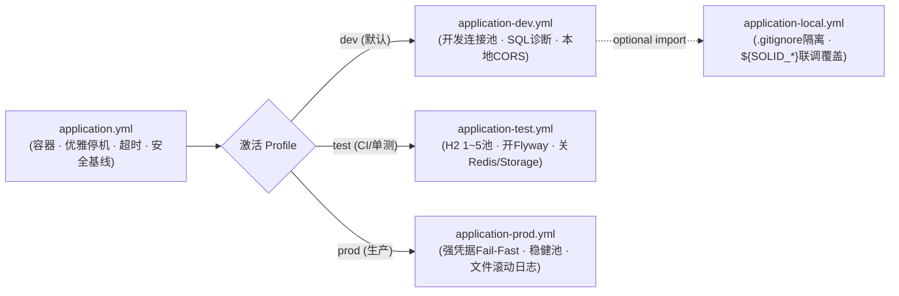

# ateng-solid-bootstrap 单体聚合宿主与双模基线模块

> 一句话定位：`ateng-solid-server` 单体运行装配入口，聚合 `auth` 与 `system` 模块并承载 `application*.yml` 双模外部化配置基线、运行时驱动及 15 条 ArchUnit 架构硬守卫。

---

## 0. 对外契约与能力全景速查矩阵

| 能力域 | 产物 / 入口 | 关键机制 / 配置段 | 运行要求与安全守卫 | 锚定验证测试 (`*Test.java`) |
| :--- | :--- | :--- | :--- | :--- |
| 启动宿主 | [`SolidApplication`](./src/main/java/io/github/atengk/solid/SolidApplication.java) | `@SpringBootApplication` + `@ConfigurationPropertiesScan("io.github.atengk.solid")` | 自动装配 `SolidTenantProperties` / `SolidAuthProperties` / `SolidSystemProperties` | [`ConfigurationBaselineIntegrationTest`](./src/test/java/io/github/atengk/solid/ConfigurationBaselineIntegrationTest.java) |
| 运行依赖 | [`pom.xml`](./pom.xml) | `ateng-boot-flyway`、`ateng-boot-observability`（仅宿主引入） + `build-info`、`caffeine`、`commons-pool2`、`mysql-connector-j`、`flyway-mysql`、`aws-sdk:{s3,apache-client}` | `caffeine` 与 `commons-pool2` 由 BOM 统管分别激活 `TwoLevelCacheManager` 与 Lettuce/Redisson 双池；离线 `test` 排除 Redis 自动装配并切换 H2 | `mvn clean test -B -T 1C -nsu` |
| 主配置基线 | [`application.yml`](./src/main/resources/application.yml) | Tomcat 队列/压缩、`shutdown: graceful`、Java 21 虚拟线程、`management`（黄金探针分级/禁 `db` 重复/闭 `env` 开 `build`）、`logging.charset` (UTF-8)、`web.{ratelimit,idempotent}`、`satoken`、`data-permission`、`S3+Guard`、`observability.{health.cache-ttl:15s,security}`、`password-hash` 池 (`queue-capacity: 1000`)、`ateng.solid.*` | 默认激活 `dev`；开 `actuator-endpoint-enabled` 与慢请求排除 `/actuator/pre-stop`、关冗余 `/pre-stop` MVC 端点、白名单收敛 `[health,info,prometheus]`；安全头 + `DENY_ALL` + `solid:` 键前缀 + 限流/幂等 `fail-open: true` | [`ConfigurationBaselineIntegrationTest`](./src/test/java/io/github/atengk/solid/ConfigurationBaselineIntegrationTest.java) |
| 开发联调配置 | [`application-dev.yml`](./src/main/resources/application-dev.yml) | 导入 `optional:classpath:application-local.yml`、Hikari (`2~10` + 10s 泄漏检测)、Lettuce (`2~8`)、Redisson (`4/4/16/4`)、`management` 详情常开与 `env=dev` 标签、SQL 诊断、`localhost` CORS | 仅在 `dev` 下导入本机覆盖文件；`active-timeout: 2h`、`payload-log: false`、`DEBUG` 级业务日志 | 本地启动联调 / 单测验证 |
| 生产基线配置 | [`application-prod.yml`](./src/main/resources/application-prod.yml) | 强凭据零默认值 `${SOLID_*}` Fail-Fast（初始超管密码 `${SOLID_INIT_SUPER_ADMIN_PASSWORD:}` 允许留空随机生成）、`flyway: ${SOLID_FLYWAY_ENABLED:false}`、`management` 双端口物理隔离（`8081`/`127.0.0.1` + `preStop` + 404 隐身）与 `env=prod` 标签、Hikari (`5~20`)、Lettuce (`4~16`)、Redisson (`8~32`)、双文件滚动日志 | 禁 OpenAPI/Knife4j/H2Console、`sql-log`/`payload-log` 与通配跨域，仅留脱敏 `slow-sql`（异步）/慢请求与 `login-defense`；观测变量均有安全默认值 | [ADR-0005](../docs/adr/0005-multi-env-configuration-and-pool-baseline.md) · [ADR-0007](../docs/adr/0007-observability-and-actuator-governance.md) |
| 本地模板 | [`application-local.example.yml`](./src/main/resources/application-local.example.yml) | MySQL 8.4 LTS、Redis 8.x、S3 Path-Style、连接池覆写占位与加密/会话密钥 `${SOLID_*}` 占位符 | 真实 `application-local.yml` 已被 `.gitignore` 忽略，模板禁含明文凭据 | 人工 / Pre-commit 门禁 |
| 离线测试桩 | [`application-test.yml`](./src/main/resources/application-test.yml) | H2 `MODE=MySQL`、Hikari (`1~5`)、`flyway.enabled: true`、排除 Redis 自动装配、`web.{ratelimit,idempotent}.enabled: false`、`web.shutdown` 快速关闭、`readiness=readinessState,dynamicDatasource`（`cache-ttl=0s`、关 `redis`/`storage` 探针、`env=test`）与测试桩密钥 | 100% 脱离 `application-local.yml` 与外部中间件自洽跑通全量测试；限流、幂等及单双端口可观测专项测试独立校验 | [`ConfigurationBaselineIntegrationTest`](./src/test/java/io/github/atengk/solid/ConfigurationBaselineIntegrationTest.java) · [`ObservabilityActuatorIntegrationTest`](./src/test/java/io/github/atengk/solid/ObservabilityActuatorIntegrationTest.java) · [`ObservabilityDualPortIntegrationTest`](./src/test/java/io/github/atengk/solid/ObservabilityDualPortIntegrationTest.java) · [`IdempotentMockMvcTest`](./src/test/java/io/github/atengk/solid/IdempotentMockMvcTest.java) · [`RateLimiterMockMvcTest`](./src/test/java/io/github/atengk/solid/RateLimiterMockMvcTest.java) |
| 可观测管理面与双端口防线 | [`ObservabilityActuatorIntegrationTest`](./src/test/java/io/github/atengk/solid/ObservabilityActuatorIntegrationTest.java) · [`ObservabilityDualPortIntegrationTest`](./src/test/java/io/github/atengk/solid/ObservabilityDualPortIntegrationTest.java) | 黄金探针分组、`db` 去重、`build-info`、Prometheus `env` 标签、404 隐身拦截与 `/actuator/pre-stop` 排空 | 验证 `liveness`/`readiness` 隔离、禁止匿名/非白名单访问 `/actuator` 与 `/actuator/pre-stop`、双端口子上下文 `[B25]` 审计拦截与 `[B24]` 防假死存储探针优先装配 | [`ObservabilityActuatorIntegrationTest`](./src/test/java/io/github/atengk/solid/ObservabilityActuatorIntegrationTest.java) · [`ObservabilityDualPortIntegrationTest`](./src/test/java/io/github/atengk/solid/ObservabilityDualPortIntegrationTest.java) |
| 认证、RBAC 防提权与租户守卫 MockMvc | [`AuthFlowMockMvcTest`](./src/test/java/io/github/atengk/solid/AuthFlowMockMvcTest.java) · [`AuthSecurityEdgeMockMvcTest`](./src/test/java/io/github/atengk/solid/AuthSecurityEdgeMockMvcTest.java) · [`TenantRuntimeGuardMockMvcTest`](./src/test/java/io/github/atengk/solid/TenantRuntimeGuardMockMvcTest.java) · [`RateLimiterMockMvcTest`](./src/test/java/io/github/atengk/solid/RateLimiterMockMvcTest.java) · [`SecurityHardeningMockMvcTest`](./src/test/java/io/github/atengk/solid/SecurityHardeningMockMvcTest.java) · [`RbacPrivilegeAndInvariantMockMvcTest`](./src/test/java/io/github/atengk/solid/RbacPrivilegeAndInvariantMockMvcTest.java) | 登录路由闭环、一次一密、`is-share: false` 独立会话、低迭代哈希升级、`101004` 防爆破、不透明句柄强退、`101005` 运行时阻断、`@RateLimiter` `429` 防刷、全链路 RBAC 防提权与多租户安全加固门禁 | 端到端校验 `/admin/auth/**` 11 端点、多端独立令牌单端强退与分页越界保护、IP/账号锁定详情、超管切租户、个人中心 `102002` 冲突、头像魔数 `100004`、匿名/导入导出/高敏写端点限流、全路径日志脱敏、分级 `config/key` 鉴权、列表脱敏/详情明文对照、同租户/子集/内置保护防提权及角色名唯一索引不变式 | [`AuthFlowMockMvcTest`](./src/test/java/io/github/atengk/solid/AuthFlowMockMvcTest.java) · [`SecurityHardeningMockMvcTest`](./src/test/java/io/github/atengk/solid/SecurityHardeningMockMvcTest.java) · [`RbacPrivilegeAndInvariantMockMvcTest`](./src/test/java/io/github/atengk/solid/RbacPrivilegeAndInvariantMockMvcTest.java) · [`TenantRuntimeGuardMockMvcTest`](./src/test/java/io/github/atengk/solid/TenantRuntimeGuardMockMvcTest.java) |
| 5 级 `@DataScope` 真实 SQL 验证 | [`DataScopeH2SqlIntegrationTest`](./src/test/java/io/github/atengk/solid/DataScopeH2SqlIntegrationTest.java) · `DataScopeVerifyMapper` | H2 `AtengDataPermissionInnerInterceptor` + `SolidDataPermissionHandler` | 真实 SQL 验证 5 级策略、`DEPT+SELF` 括号防穿透、`create_by` 字符串分支、空角色/停用角色/无部门 `1=0` 与超限 `100003` 透传 | [`DataScopeH2SqlIntegrationTest`](./src/test/java/io/github/atengk/solid/DataScopeH2SqlIntegrationTest.java) |
| 组织架构与 RBAC 集成/HTTP/并发边界 | [`OrgAndRbacIntegrationTest`](./src/test/java/io/github/atengk/solid/OrgAndRbacIntegrationTest.java) · [`OrgAndRbacConcurrencyAndBoundsIntegrationTest`](./src/test/java/io/github/atengk/solid/OrgAndRbacConcurrencyAndBoundsIntegrationTest.java) · [`ConcurrencyHardeningIntegrationTest`](./src/test/java/io/github/atengk/solid/ConcurrencyHardeningIntegrationTest.java) · [`OrgAndRbacEdgeIntegrationTest`](./src/test/java/io/github/atengk/solid/OrgAndRbacEdgeIntegrationTest.java) · [`OrgAndRbacMockMvcTest`](./src/test/java/io/github/atengk/solid/OrgAndRbacMockMvcTest.java) | `/admin/system/{dept,post,menu,role,dict,tenant-package}/**`、树写锁/分段互斥锁、行锁顺序与 `ancestors <= 500`/深度 `<= 10` 防护 | 验证部门 `ancestors` 批量重算、部门/菜单互迁互斥锁、套餐行锁与建租户串行化、逆序批量删防死锁、字典类型/明细零孤儿、深度超限 `100001`、禁用负责人校验、半选套餐兼容、保留词 `102004`/内置 `102007`/越界 `102006` 与双模恢复 | [`OrgAndRbacConcurrencyAndBoundsIntegrationTest`](./src/test/java/io/github/atengk/solid/OrgAndRbacConcurrencyAndBoundsIntegrationTest.java) · [`ConcurrencyHardeningIntegrationTest`](./src/test/java/io/github/atengk/solid/ConcurrencyHardeningIntegrationTest.java) · [`OrgAndRbacMockMvcTest`](./src/test/java/io/github/atengk/solid/OrgAndRbacMockMvcTest.java) |
| 用户 CRUD、配额行锁与 500 行导入导出 | [`SysUserCrudAndDataScopeTest`](./src/test/java/io/github/atengk/solid/SysUserCrudAndDataScopeTest.java) · [`SysUserExcelImportIntegrationTest`](./src/test/java/io/github/atengk/solid/SysUserExcelImportIntegrationTest.java) · [`ValidationAndExportCapMockMvcTest`](./src/test/java/io/github/atengk/solid/ValidationAndExportCapMockMvcTest.java) | `/admin/system/user/**`、5 级 `@DataScope`、悲观行锁、三段式导入、导出上限 `50,000` 与全量校验 | 验证用户 5 级读写隔离、并发配额不超卖、内置超管保护 `102007`、并发哈希与 `403/404` 批注隔离下载、全量 Bean Validation 与 100 主键上限 | [`SysUserCrudAndDataScopeTest`](./src/test/java/io/github/atengk/solid/SysUserCrudAndDataScopeTest.java) · [`ValidationAndExportCapMockMvcTest`](./src/test/java/io/github/atengk/solid/ValidationAndExportCapMockMvcTest.java) |
| 多租户初始化、套餐裁剪与游标强退 | [`TenantAndPackageIntegrationTest`](./src/test/java/io/github/atengk/solid/TenantAndPackageIntegrationTest.java) · [`TenantKickoutAndExpireIntegrationTest`](./src/test/java/io/github/atengk/solid/TenantKickoutAndExpireIntegrationTest.java) · [`RemoteServicesIntegrationTest`](./src/test/java/io/github/atengk/solid/RemoteServicesIntegrationTest.java) | `/admin/system/{tenant,tenant-package}/**`、`Remote*Service`、4 步初始化与 500 游标强退 | 验证租户 `0` 保护 `102003`、4 步行锁与回滚、停删或 `expireTime <= now` 游标批扫强退会话及套餐跨租户裁剪 | [`TenantKickoutAndExpireIntegrationTest`](./src/test/java/io/github/atengk/solid/TenantKickoutAndExpireIntegrationTest.java) · [`TenantAndPackageIntegrationTest`](./src/test/java/io/github/atengk/solid/TenantAndPackageIntegrationTest.java) |
| 枚举、字典、参数、SQL 转义与排序防线 | [`SysEnumControllerMockMvcTest`](./src/test/java/io/github/atengk/solid/SysEnumControllerMockMvcTest.java) · [`SysDictAndConfigIntegrationTest`](./src/test/java/io/github/atengk/solid/SysDictAndConfigIntegrationTest.java) · [`AuditLogIntegrationAndMockMvcTest`](./src/test/java/io/github/atengk/solid/AuditLogIntegrationAndMockMvcTest.java) · [`SqlLikeSortAndTreeCycleIntegrationTest`](./src/test/java/io/github/atengk/solid/SqlLikeSortAndTreeCycleIntegrationTest.java) | `/admin/system/{enums,dict,config,log}/**`、`LIKE ... ESCAPE '!'` 与 `pageRequest.orders()` 回退 | 验证 7 项静态枚举鉴权与批量上限、字典参数两级缓存、全站 SQL `LIKE` 通配符转义与非法排序回退默认排序 | [`SqlLikeSortAndTreeCycleIntegrationTest`](./src/test/java/io/github/atengk/solid/SqlLikeSortAndTreeCycleIntegrationTest.java) · [`AuditLogIntegrationAndMockMvcTest`](./src/test/java/io/github/atengk/solid/AuditLogIntegrationAndMockMvcTest.java) |
| 持久层加密、迁移与引导验证 | [`FlywaySchemaAndSeedIntegrationTest`](./src/test/java/io/github/atengk/solid/FlywaySchemaAndSeedIntegrationTest.java) · [`ContactFieldEncryptPersistenceTest`](./src/test/java/io/github/atengk/solid/ContactFieldEncryptPersistenceTest.java) · [`SuperAdminBootstrapperIntegrationTest`](./src/test/java/io/github/atengk/solid/SuperAdminBootstrapperIntegrationTest.java) | 17 表迁移（`V1.0.0~V1.0.2`）、58 条菜单种子、SIV 加密往返与超管首次启动引导 | 校验 17 张表、确定性种子与 `uk_role_tenant_name_deleted` 唯一索引落库、`"v1:..."` 密文写入、ORM 解密、多 `NULL` 放行、软删重建与超管一次性强随机口令幂等初始化 | [`FlywaySchemaAndSeedIntegrationTest`](./src/test/java/io/github/atengk/solid/FlywaySchemaAndSeedIntegrationTest.java) · [`ContactFieldEncryptPersistenceTest`](./src/test/java/io/github/atengk/solid/ContactFieldEncryptPersistenceTest.java) · [`SuperAdminBootstrapperIntegrationTest`](./src/test/java/io/github/atengk/solid/SuperAdminBootstrapperIntegrationTest.java) |
| 架构守卫与 `system-api` 契约 | [`ArchitectureGuardTest`](./src/test/java/io/github/atengk/solid/ArchitectureGuardTest.java) · [`SystemApiContractTest`](./src/test/java/io/github/atengk/solid/SystemApiContractTest.java) | 15 条 ArchUnit 硬红线 + 契约二进制序列化锁定 | 阻断跨模块逆向依赖、Controller 调 `*Mapper`/漏鉴权、非 Web 边界 Servlet 泄漏、`@Value`/`@RefreshScope`、`Result` 契约污染及 9 个 DTO/Command 可序列化往返 | [`ArchitectureGuardTest`](./src/test/java/io/github/atengk/solid/ArchitectureGuardTest.java) · [`SystemApiContractTest`](./src/test/java/io/github/atengk/solid/SystemApiContractTest.java) |
| 错误码防碰撞 | [`ResultCodeSegmentTest`](./src/test/java/io/github/atengk/solid/ResultCodeSegmentTest.java) | 千位号段校验 + 类路径 `IResultCode` 全扫描 | 校验 `100xxx`/`101xxx`/`102xxx` 无越界且与底座全部错误码零重复 | [`ResultCodeSegmentTest`](./src/test/java/io/github/atengk/solid/ResultCodeSegmentTest.java) |
| `local` 真实中间件验证 | [`LocalRedisCapabilityIntegrationTest`](./src/test/java/io/github/atengk/solid/LocalRedisCapabilityIntegrationTest.java) · [`LocalRateLimiterMockMvcTest`](./src/test/java/io/github/atengk/solid/LocalRateLimiterMockMvcTest.java) · [`LocalStorageIntegrationTest`](./src/test/java/io/github/atengk/solid/LocalStorageIntegrationTest.java) | `@Tag("local")` + `-Dsolid.local.test=true`（`dev` Profile + 动态前缀隔离） | 默认离线 `mvn test` 自动跳过；激活后实机验证真实 MySQL、Caffeine+Pub/Sub、L2 空哨兵、分布式锁/幂等/信号量、双键批注、Redisson 限流及 S3 上传/2h `inline` 预签名/事务回滚防孤儿/提交后删旧头像 | [`LocalRedisCapabilityIntegrationTest`](./src/test/java/io/github/atengk/solid/LocalRedisCapabilityIntegrationTest.java) · [`LocalRateLimiterMockMvcTest`](./src/test/java/io/github/atengk/solid/LocalRateLimiterMockMvcTest.java) · [`LocalStorageIntegrationTest`](./src/test/java/io/github/atengk/solid/LocalStorageIntegrationTest.java) |

---

## 1. 模块定位与本地启动

- **严禁业务侵入**：本模块严禁编写业务 `@RestController`、`@Controller`、`@Service` 或 `*Mapper`，也不私藏业务域 Flyway 脚本（均由 `ArchitectureGuardTest` 规则 5 守卫）。
- **本地开发启动准备**：将 [`application-local.example.yml`](./src/main/resources/application-local.example.yml) 复制为同目录受忽略的 `application-local.yml`，填入本机 MySQL 8.4、Redis 8.x、S3/RustFS 与加解密密钥占位值即可启动。

```bash
# 默认离线全模块验证（自动跳过 @Tag("local") 用例）
mvn clean test -B -T 1C -nsu

# 本地真实 MySQL + Redis + S3 专项实机验证（需提前就绪 application-local.yml 与 SOLID_* 环境变量）
mvn test "-Dtest=LocalRedisCapabilityIntegrationTest,LocalRateLimiterMockMvcTest,LocalStorageIntegrationTest" "-Dsurefire.failIfNoSpecifiedTests=false" "-Dsolid.local.test=true" -B -nsu
```

---

## 2. 五档分层配置与安全加载架构



- **优雅停机与可观测管理面**：仅在本启动宿主模块引入 `ateng-boot-observability`，开启 `ateng.boot.web.shutdown.actuator-endpoint-enabled: true` 并锁定 `mvc-endpoint-enabled: false` 关闭冗余 `/pre-stop` MVC 端点，排空触发 `/actuator/pre-stop` 已剔除出免密白名单并排除出慢请求监控；`dev`/`test` 维持单端口暴露只读 `health,info,prometheus`，`prod` 启用物理双端口隔离（默认 `8081` 绑定 `127.0.0.1`）与 404 隐身安全防线，同时落实 `liveness`/`readiness` 分级（`readiness` 排除 `storage` 且屏蔽原生 `db` 重复探针）、`build-info` 与 Prometheus `env` 标签，联动 [`scripts/server.sh`](../scripts/server.sh) `--mgmt-port` 与 `readiness` 就绪探活；生产启动接受 `ateng.boot.web.sanity-check` 零告警校验（详见 [`ADR-0005`](../docs/adr/0005-multi-env-configuration-and-pool-baseline.md) 与 [`ADR-0007`](../docs/adr/0007-observability-and-actuator-governance.md)）。

---

## 3. 核心基线配置与 15 条架构守卫

### 3.1 `ateng-boot` 安全基线与 `password-hash` 专属线程池（`application.yml`）

1. **核心配置段（提取自已验证 `application.yml`）**：

```yaml
ateng:
  boot:
    async:
      pools:
        password-hash:
          mode: platform
          core-pool-size: 4
          max-pool-size: 6
          queue-capacity: 1000
    satoken:
      primary-login-type: admin
      super-admin-roles:
        - super_admin
      permission-cache:
        tenant-scoped: true
      tenant:
        header-name: X-Tenant-Id
        allow-anonymous-header: false
        allow-super-admin-switch: true
        platform-tenant-ids:
          - "0"
    mybatis-plus:
      data-permission:
        enabled: true
        failure-strategy: DENY_ALL
```

2. **配置属性与底座绑定**：`ateng.boot.async.pools.password-hash` 强制使用 `platform` 平台线程池，避免 PBKDF2 高 CPU 运算钉死 Java 21 虚拟线程载体；`ateng.boot.satoken.super-admin-roles` 仅包含 `super_admin`，防止将普通租户内置 `admin` 误判为全平台超管。
3. **边界防御**：`mybatis-plus.data-permission.failure-strategy` 锁定为 `DENY_ALL`，数据权限解析异常默认拒访保护敏感租户数据；`storage.guard` 强制开启扩展名白名单、严格魔数校验与 `2MB` 单图上限，同时锁定 `local.upload-endpoint-enabled: false`。

### 3.2 五档配置分层、Fail-Fast 与连接池定容（`ADR-0005`）

- **Profile 隔离链路**：`application.yml` 默认激活 `dev`，仅 `application-dev.yml` 通过 `optional:classpath:application-local.yml` 接入本机配置；`test` 物理隔离本地覆盖；`prod` 强制要求 11 项基础设施与安全密钥 `${SOLID_*}` 零默认值 Fail-Fast（`SOLID_INIT_SUPER_ADMIN_PASSWORD` 允许留空并触发首次启动生成 16 位强随机口令）。
- **虚线程连接池与双池化**：`commons-pool2` 激活 Lettuce（`dev 2~8` / `prod 4~16`）与 Redisson（`dev 4~16` / `prod 8~32`），HikariCP 按 `test 1~5` / `dev 2~10` / `prod 5~20` 分级定容（`prod` 默认关闭 `sql-log`/`payload-log` 与 `open-in-view`）。

### 3.3 Redis 收敛、TwoLevel 两级缓存与自适应降级（`ADR-0006`）

- 全部缓存、会话、分布式锁、信号量、限流与批注双键统一收口至 `ateng.boot.redis.key-prefix: "solid:"`；
- 字典/参数/权限激活 Caffeine + Redis `TwoLevelCacheManager` 加速读取与广播失效，租户状态采用纯 L2 `RedisCacheTemplate`；测试或无 Redis 故障时由 `AdaptiveRedisSupport` 自动降级为有界本地 LRU（上限 `10,000`）+ 分段 `ReentrantLock`。

### 3.4 可观测管理面、双端口与 `preStop` 治理（`ADR-0007`）

- 仅 `bootstrap` 引入 `ateng-boot-observability`，`dev`/`test` 维持单端口暴露只读 `health,info,prometheus`；`prod` 独立管理端口（`8081` 绑定 `127.0.0.1`）启用 `stealth-mode`（404 隐身）与来源网段/Token 防线并按 `liveness`/`readiness`（排除 `storage`、禁原生 `db`、`cache-ttl: 15s`）接入 K8s 探针与受控 `/actuator/pre-stop` 优雅排空。

### 3.5 15 条 ArchUnit 架构红线（`ArchitectureGuardTest`）

| 序号 | 守卫方法 | 强制拦截红线 |
| :---: | :--- | :--- |
| 1 | `authMustNotDependOnSystemImplementation` | `auth` 禁止依赖 `system` 除 `system.api` 外的全部实现包 |
| 2 | `systemApiMustRemainFrameworkPure` | `system-api` 禁止引入 Web、MyBatis-Plus、Redis、Feign、Dubbo 或 Servlet |
| 3 | `noFieldInjectionAllowed` | 全局禁止 `@Autowired` / `@Resource` 字段注入 |
| 4 | `controllersMustNotLeakEntities` | Controller 公开方法出入参（含泛型）禁止暴露 `.entity` 包实体 |
| 5 | `bootstrapMustNotContainBusinessControllersOrMappers` | `bootstrap` 根包及子包禁止出现业务 Controller 与 `*Mapper` |
| 6 | `serviceMustNotDependOnServlet` | Service 层禁止依赖 `jakarta.servlet..` |
| 7 | `mapperMustNotDependOnControllerOrService` | Mapper 持久层禁止反向依赖 Controller 或 Service |
| 8 | `systemApiMustNotExposeResultWrapper` | `system-api` 方法签名、泛型及字段严禁引用 `Result<T>` |
| 9 | `noValueOrRefreshScopeAllowed` | 全局禁止使用 Spring `@Value` 与 `@RefreshScope`（强类型收口 `@ConfigurationProperties`） |
| 10 | `systemMustNotDependOnAuth` | `system` 模块严禁反向依赖 `auth` 模块 |
| 11 | `commonMustNotDependOnUpstreamModules` | `common` 模块严禁反向依赖 `system`、`auth` 或 `bootstrap` 上层模块 |
| 12 | `controllersMustNotDependOnMappers` | 全部 Controller 严禁越级注入或直接调用持久层 `*Mapper` |
| 13 | `controllerHttpMappingsMustDeclareExplicitAuthOrAnonymous` | 全部 Controller HTTP 映射方法必须在类或方法上显式标注 `@SaCheck*` 或 `@Anonymous` |
| 14 | `systemApiDtosAndCommandsMustImplementSerializable` | `system-api` 全部具体 DTO 与 Command 类（排除 Lombok Builder）必须实现 `Serializable` |
| 15 | `nonWebBoundaryPackagesMustNotDependOnServlet` | `service` / `support` / `grant` 与非 `HandlerInterceptor` 的 `security` 类严禁依赖 `jakarta.servlet..`（精准豁免 `TenantAvailabilityInterceptor`） |

---

## 4. 非功能基线与待关注上游约束

- **离线可测性**：`test` Profile 已激活 `spring.flyway.enabled: true`，每次离线测试在 H2（`MODE=MySQL;DATABASE_TO_LOWER=TRUE`）自动执行 `V1.0.0`（17 张表）、`V1.0.1`（58 条菜单及基础元数据种子）与 `V1.0.2`（`sys_role` 租户+角色名唯一索引）并完成 `ContactFieldCrypto` 确定性加密持久化验证。
- **底座枚举字典扫描现状**：当前 `EnumDictionaryRegistry` 已扫描注册首期全部 `7` 个实现 `IBaseEnum` 的静态枚举，涵盖业务 `6` 项（`commonStatus`、`logStatus`、`configType`、`dataScopeType`、`menuType`、`visibleStatus`）以及 `ateng-boot` 底座审计操作类型枚举 `operateType`（`io.github.atengk.boot.core.audit.OperateTypeEnum`），并统一由 `ateng-solid-system` 的 `SysEnumController` 经 `@SaCheckLogin` 对外暴露。

---

## 5. 完整业务配置项字典（`ateng.solid.*`）

| 配置键前缀 | 配置字段 | 默认值（`application.yml`） | 归属配置类（模块） |
| :--- | :--- | :--- | :--- |
| `ateng.solid.tenant` | `enabled` / `status-cache-ttl` | `false` / `60s` | `SolidTenantProperties`（`common`） |
| `ateng.solid.auth` | `captcha-enabled` / `session-handle-secret` | `true` / `""` | `SolidAuthProperties`（`auth`） |
| `ateng.solid.init` | `enabled` / `super-admin-username` / `super-admin-nickname` / `super-admin-password` | `true` / `"superadmin"` / `"超级管理员"` / `""` | `SolidSystemProperties.InitProperties`（`system`） |
| `ateng.solid.data-scope` | `max-dept-in-size` | `1000` | `SolidSystemProperties.DataScopeProperties`（`system`） |
| `ateng.solid.user` | `import-max-rows` / `max-concurrent-imports` / `import-feedback-ttl` | `500` / `2` / `15m` | `SolidSystemProperties.UserProperties`（`system`） |
| `ateng.solid.cache` | `dict-ttl` / `config-ttl` | `30m` / `30m` | `SolidSystemProperties.CacheProperties`（`system`） |
