# ateng-solid-common 后端共享原语与跨模块端口模块

> 一句话定位：承载 `ateng-solid-server` 跨模块共享的全局常量、公共业务错误码（`100000~100999`）、基础状态枚举、统一强口令校验器、领域事件发布端口与认证扩展 SPI，零数据库实体与 Web 控制器依赖。

---

## 0. 对外契约与能力全景速查矩阵

| 能力域 | 特性名称 | 核心类 / 接口 / SPI | 关键配置项 / 枚举别名 | 核心输入/输出与错误码 | 锚定验证测试 (`*Test.java`) |
| :--- | :--- | :--- | :--- | :--- | :--- |
| 全局常量 | 租户与账号体系常量 | [`SolidConstants`](./src/main/java/io/github/atengk/solid/common/constant/SolidConstants.java) | 无 | `PLATFORM_TENANT_ID = 0L`、`PLATFORM_TENANT_CODE = "000000"`、`ADMIN_LOGIN_TYPE = "admin"`、`SUPER_ADMIN_ROLE = "super_admin"` | 纯常量类（随 [`ArchitectureGuardTest`](../ateng-solid-bootstrap/src/test/java/io/github/atengk/solid/ArchitectureGuardTest.java) 守卫编译隔离） |
| 公共错误码 | 公共业务错误码段 | [`CommonBizResultCode`](./src/main/java/io/github/atengk/solid/common/result/CommonBizResultCode.java) | 无 | `100001`–`100005`（实现 `IResultCode`） | [`ResultCodeSegmentTest`](../ateng-solid-bootstrap/src/test/java/io/github/atengk/solid/ResultCodeSegmentTest.java) |
| 基础枚举 | 通用启停与日志状态 | [`CommonStatusEnum`](./src/main/java/io/github/atengk/solid/common/enums/CommonStatusEnum.java)、[`LogStatusEnum`](./src/main/java/io/github/atengk/solid/common/enums/LogStatusEnum.java) | 注册别名：`commonStatus`、`logStatus` | 实现 `IBaseEnum<Integer>`（`0` / `1`） | [`ConfigurationBaselineIntegrationTest`](../ateng-solid-bootstrap/src/test/java/io/github/atengk/solid/ConfigurationBaselineIntegrationTest.java) |
| 口令校验 | 全局强口令复杂度校验 | [`PasswordPolicyValidator`](./src/main/java/io/github/atengk/solid/common/validator/PasswordPolicyValidator.java) | `MIN_LENGTH=8`, `MAX_LENGTH=20`, `MIN_CATEGORY_COUNT=3` | `isValid(String)` / `validate(String)` 失败抛 `100001` | [`PasswordPolicyValidatorTest`](./src/test/java/io/github/atengk/solid/common/validator/PasswordPolicyValidatorTest.java) |
| 领域事件 | 事件契约与提交后发布 | [`DomainEvent`](./src/main/java/io/github/atengk/solid/common/event/DomainEvent.java)、[`DomainEventPublisher`](./src/main/java/io/github/atengk/solid/common/event/DomainEventPublisher.java)、[`SpringDomainEventPublisher`](./src/main/java/io/github/atengk/solid/common/event/SpringDomainEventPublisher.java)、[`LoginAuditEvent`](./src/main/java/io/github/atengk/solid/common/event/LoginAuditEvent.java) | 默认装配 `@Component`（Cloud 壳用 `@Primary` 覆盖） | `publish` / `publishAfterCommit` + `AsyncContext` 透传 | [`SpringDomainEventPublisherTest`](./src/test/java/io/github/atengk/solid/common/event/SpringDomainEventPublisherTest.java) |
| 认证扩展 | 认证授权策略 SPI | [`AuthGrantHandler`](./src/main/java/io/github/atengk/solid/common/spi/auth/AuthGrantHandler.java)、[`AuthGrantCommand`](./src/main/java/io/github/atengk/solid/common/spi/auth/AuthGrantCommand.java)、[`AuthenticatedPrincipal`](./src/main/java/io/github/atengk/solid/common/spi/auth/AuthenticatedPrincipal.java) | `grantType`（默认 `"password"`） | `getGrantType()` / `authenticate(AuthGrantCommand)` | [`PasswordAuthGrantHandlerTest`](../ateng-solid-auth/src/test/java/io/github/atengk/solid/auth/grant/PasswordAuthGrantHandlerTest.java)<br/>[`AuthServiceAndProfileTest`](../ateng-solid-auth/src/test/java/io/github/atengk/solid/auth/service/AuthServiceAndProfileTest.java)<br/>[`AuthFlowMockMvcTest`](../ateng-solid-bootstrap/src/test/java/io/github/atengk/solid/AuthFlowMockMvcTest.java) |
| 多租户配置 | 多租户开关与缓存 TTL | [`SolidTenantProperties`](./src/main/java/io/github/atengk/solid/common/properties/SolidTenantProperties.java) | `ateng.solid.tenant.{enabled, status-cache-ttl}` | 默认 `enabled = false`、`statusCacheTtl = 60s` | [`ConfigurationBaselineIntegrationTest`](../ateng-solid-bootstrap/src/test/java/io/github/atengk/solid/ConfigurationBaselineIntegrationTest.java) |

---

## 1. 模块定位与依赖边界

- **依赖最小化**：仅引入 `io.github.atengk:ateng-boot-core` 与 `jakarta.validation-api`；`spring-boot-autoconfigure` 与 `spring-boot-configuration-processor` 声明为 `<optional>true</optional>`，确保 `ateng-solid-system-api` 传递依赖本模块时不污染纯 Java 契约边界。
- **同源引入方式**：上游 `system-api`、`system`、`auth` 与二期扩展模块直接依赖本模块坐标即可复用：

```xml
<dependency>
    <groupId>io.github.atengk</groupId>
    <artifactId>ateng-solid-common</artifactId>
</dependency>
```

---

## 2. 核心架构与事件流转

```mermaid
flowchart LR
    AUTH["ateng-solid-auth / 业务模块"] -->|"publish / publishAfterCommit"| PORT["DomainEventPublisher 接口"]
    PORT -->|"单体默认 Bean (@Component)"| SPRING["SpringDomainEventPublisher"]
    SPRING -->|"1. AsyncContext.wrap 抓取四维快照"| TX["TransactionUtil.executeAfterCommit"]
    TX -->|"2. 物理提交成功或无事务直通"| PUB["ApplicationEventPublisher.publishEvent"]
    PUB -->|"3. 异步监听转调"| SYS["ateng-solid-system (@EventListener)"]
```



---

## 3. 核心原语与跨模块能力

### 3.1 强口令策略校验器（`PasswordPolicyValidator`）

1. **规则参数**：长度 `8~20` 个字符、禁止空白/控制字符，且至少包含 ASCII 大写字母、小写字母、数字与可打印符号中的 `3` 类；全平台超管初始化引导、后台建号、重置密码与个人自助改密共用同一校验入口。
2. **代码调用（提取自已验证单测契约）**：

```java
boolean ok = PasswordPolicyValidator.isValid("Ateng@Solid2026");
PasswordPolicyValidator.validate(rawPassword);
```

3. **边界防御**：传入 `null`、空串、含空格/制表符/换行符/`\u00A0` 或字符类别不足 `3` 类时，`isValid` 返回 `false`，`validate` 抛出 `BusinessException(CommonBizResultCode.PARAM_INVALID, ...)`（状态码 `100001`）。

### 3.2 领域事件端口与事务提交后广播（`DomainEventPublisher`）

1. **装配与配置**：`SpringDomainEventPublisher` 标记为 `@Component`，无额外配置项；Cloud 微服务壳新增实现类时标注 `@Primary` 即可无侵入替换。
2. **代码调用（提取自已验证发布契约）**：

```java
LoginAuditEvent event = LoginAuditEvent.builder()
        .tenantId(0L)
        .traceId(traceId)
        .userId(userId)
        .username(username)
        .loginType(SolidConstants.ADMIN_LOGIN_TYPE)
        .action(LoginAuditEvent.ACTION_LOGIN)
        .clientIp(clientIp)
        .userAgent(userAgent)
        .status(LogStatusEnum.SUCCESS.getCode())
        .message("登录成功")
        .build();

domainEventPublisher.publish(event);
domainEventPublisher.publishAfterCommit(event);
```

3. **边界防御**：`event` 为 `null` 时立刻快速失败抛出 `NullPointerException`；调用 `publishAfterCommit` 时先于当前线程通过 `AsyncContext.wrap(...)` 冻结 MDC/租户/用户上下文快照，仅当底层物理事务 `commit` 成功后投递，事务回滚绝不误发，无活跃事务同步器时平滑降级为就地发布。

### 3.3 多租户开关配置（`SolidTenantProperties`）

1. **YAML 配置基线（含默认值）**：

```yaml
ateng:
  solid:
    tenant:
      enabled: false          # 默认单租户开箱模式；开启 SaaS 多租户时同步打开 mybatis-plus.tenant.enabled
      status-cache-ttl: 60s   # TenantAuthDTO 状态缓存 TTL（读时仍校验实时时间以实现 0 秒过期截断）
```

2. **属性读取与关联边界**：由 `SolidApplication` 的 `@ConfigurationPropertiesScan("io.github.atengk.solid")` 自动绑定，禁止在业务类中使用 `@Value` 零散注入。

---

## 4. 扩展点（SPI）与非功能边界

- **认证策略扩展点 `AuthGrantHandler`**：通过 `getGrantType()` 声明授权模式标识，通过 `authenticate(AuthGrantCommand)` 返回标准化的 `AuthenticatedPrincipal`（`roles`/`permissions` 默认保底为空集合 `Collections.emptyList()`）；新增短信或三方 OAuth2 登录只需实现该 SPI 并注册为 Spring Bean，无需修改核心 `auth` 分支路由。
- **敏感字段脱敏防护**：`AuthGrantCommand` 重写 `@ToString(exclude = "password")`，防止诊断日志打印明文口令。
- **规范守则**：跨模块边界详见 [同源双装配守则](../docs/agents/cloud-readiness.md)，公共错误码契约详见 [api-and-error-codes-spec.md](../docs/specs/api-and-error-codes-spec.md)。

---

## 5. 完整常量、基础枚举与错误码附录

### 5.1 全局常量（`SolidConstants`）

| 常量名 | 常量值 | 用途 |
| :--- | :--- | :--- |
| `DEFAULT_TENANT_ID` / `PLATFORM_TENANT_ID` | `0L` | 平台内置默认租户主键 |
| `PLATFORM_TENANT_ID_STR` | `"0"` | 平台默认租户字符串标识 |
| `DEFAULT_TENANT_CODE` / `PLATFORM_TENANT_CODE` | `"000000"` | 平台默认租户业务编码 |
| `SUPER_ADMIN_ROLE_ID` | `1L` | 平台内置超级管理员角色主键 |
| `SUPER_ADMIN_ROLE` | `"super_admin"` | 平台超级管理员角色编码 |
| `RESERVED_ADMIN_ROLE` | `"admin"` | 系统保留角色编码（禁用户自定义占用） |
| `DEFAULT_ROOT_DEPT_ID` | `100L` | 平台默认根部门主键 |
| `ADMIN_LOGIN_TYPE` | `"admin"` | 管理端 Sa-Token 多账号登录体系 |
| `DEFAULT_GRANT_TYPE` | `"password"` | 默认账号密码授权模式 |
| `INIT_PASSWORD_CONFIG_KEY` | `"sys.user.initPassword"` | 初始密码系统参数键名 |
| `TENANT_HEADER_NAME` | `"X-Tenant-Id"` | 多租户切换请求头 |
| `TRACE_HEADER_NAME` | `"X-Trace-Id"` | 链路追踪请求头 |
| `PASSWORD_HASH_POOL_NAME` | `"password-hash"` | 密码慢哈希受管线程池别名 |

### 5.2 基础枚举与公共错误码（`100000~100999`）

- `CommonStatusEnum`（别名 `commonStatus`）：`NORMAL(0, "正常")`、`DISABLED(1, "停用")`。
- `LogStatusEnum`（别名 `logStatus`）：`SUCCESS(0, "成功")`、`FAIL(1, "失败")`。

| 枚举常量 | 错误码 | 默认提示文案 | 典型触发场景 |
| :--- | :---: | :--- | :--- |
| `PARAM_INVALID` | `100001` | 业务参数格式或约束不合法 | 口令复杂度不足、树节点自环、`F` 节点挂错、自定部门未勾选 |
| `INVALID_TENANT_SWITCH` | `100002` | 目标租户不存在、已停用或已过期，无法切换 | `TenantHeaderSwitchValidator` 拦截超管切往失效租户（不注销 `"0"` 会话） |
| `DATA_SCOPE_ERROR` | `100003` | 数据权限配置或范围校验异常 | `DEPT_AND_CHILD` 子孙部门数量超过 `maxDeptInSize` |
| `FILE_GUARD_REJECTED` | `100004` | 上传文件格式不合法或大小超出限制 | 头像/导入文件扩展名、魔数或体积被安全守卫拦截 |
| `EXCEL_VALIDATION_FAILED` | `100005` | Excel 文件格式、表头或导入行数校验失败 | Excel 表头损坏或有效数据超过单批上限 |
