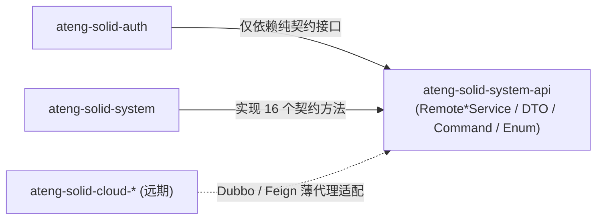

# ateng-solid-system-api 系统管理域纯 Java 跨模块契约模块

> 一句话定位：定义系统管理域对外暴露的 4 个纯 Java `Remote*Service` 契约接口（16 方法）、跨模块 DTO/Command 模型、4 个系统级枚举与系统错误码段（`102000~102999`），实现单体模块隔离与微服务同源双装配。

---

## 0. 对外契约与能力全景速查矩阵

| 能力域 | 契约类 / 接口 | 公开方法 / 枚举值（数量） | 关键边界与空值/异常约定 | 关联文档 / 锚定测试 |
| :--- | :--- | :--- | :--- | :--- |
| 系统错误码 | [`SystemResultCode`](./src/main/java/io/github/atengk/solid/system/api/result/SystemResultCode.java) | `102001`–`102007`（7 项） | 落在 `102000~102999` 号段，全局无碰撞 | [`ResultCodeSegmentTest`](../ateng-solid-bootstrap/src/test/java/io/github/atengk/solid/ResultCodeSegmentTest.java) |
| 系统枚举 | [`DataScopeType`](./src/main/java/io/github/atengk/solid/system/api/enums/DataScopeType.java) | `1..5`（`ALL`/`CUSTOM`/`DEPT`/`DEPT_AND_CHILD`/`SELF`） | 枚举别名 `dataScopeType` | [`ConfigurationBaselineIntegrationTest`](../ateng-solid-bootstrap/src/test/java/io/github/atengk/solid/ConfigurationBaselineIntegrationTest.java) |
| 系统枚举 | [`MenuTypeEnum`](./src/main/java/io/github/atengk/solid/system/api/enums/MenuTypeEnum.java) | `"M"` 目录 / `"C"` 菜单 / `"F"` 按钮 | 枚举别名 `menuType` | [`ConfigurationBaselineIntegrationTest`](../ateng-solid-bootstrap/src/test/java/io/github/atengk/solid/ConfigurationBaselineIntegrationTest.java) |
| 系统枚举 | [`ConfigTypeEnum`](./src/main/java/io/github/atengk/solid/system/api/enums/ConfigTypeEnum.java) | `"Y"` 系统内置 / `"N"` 业务自建 | 枚举别名 `configType` | [`ConfigurationBaselineIntegrationTest`](../ateng-solid-bootstrap/src/test/java/io/github/atengk/solid/ConfigurationBaselineIntegrationTest.java) |
| 系统枚举 | [`VisibleStatusEnum`](./src/main/java/io/github/atengk/solid/system/api/enums/VisibleStatusEnum.java) | `0` 显示 / `1` 隐藏 | 枚举别名 `visibleStatus` | [`ConfigurationBaselineIntegrationTest`](../ateng-solid-bootstrap/src/test/java/io/github/atengk/solid/ConfigurationBaselineIntegrationTest.java) |
| 用户契约 | [`RemoteUserService`](./src/main/java/io/github/atengk/solid/system/api/service/RemoteUserService.java) | 8 方法（认证查询、资料读写、头像、改密/平滑升级哈希） | 显式 `tenantId`；单查返 `null` 或抛 `102001`；禁明文密文回流 | [`ArchitectureGuardTest`](../ateng-solid-bootstrap/src/test/java/io/github/atengk/solid/ArchitectureGuardTest.java)<br/>[`SystemApiContractTest`](../ateng-solid-bootstrap/src/test/java/io/github/atengk/solid/SystemApiContractTest.java) |
| 租户契约 | [`RemoteTenantService`](./src/main/java/io/github/atengk/solid/system/api/service/RemoteTenantService.java) | 3 方法（按编码/主键查租户、可用性校验） | 返回 `TenantAuthDTO`（含 `isAvailableAt`）或 `boolean` | [`ArchitectureGuardTest`](../ateng-solid-bootstrap/src/test/java/io/github/atengk/solid/ArchitectureGuardTest.java)<br/>[`SystemApiContractTest`](../ateng-solid-bootstrap/src/test/java/io/github/atengk/solid/SystemApiContractTest.java) |
| 权限契约 | [`RemotePermissionService`](./src/main/java/io/github/atengk/solid/system/api/service/RemotePermissionService.java) | 4 方法（角色、角色权限、直赋权限、动态路由树） | 集合查询无匹配保底返回空集合 `[]` | [`ArchitectureGuardTest`](../ateng-solid-bootstrap/src/test/java/io/github/atengk/solid/ArchitectureGuardTest.java)<br/>[`SystemApiContractTest`](../ateng-solid-bootstrap/src/test/java/io/github/atengk/solid/SystemApiContractTest.java) |
| 审计契约 | [`RemoteAuditLogService`](./src/main/java/io/github/atengk/solid/system/api/service/RemoteAuditLogService.java) | 1 方法（`recordLoginAudit`） | 消费 `LoginAuditCommand`（含 `action`），幂等写日志并仅在登录成功时回写轨迹 | [`ArchitectureGuardTest`](../ateng-solid-bootstrap/src/test/java/io/github/atengk/solid/ArchitectureGuardTest.java)<br/>[`SystemApiContractTest`](../ateng-solid-bootstrap/src/test/java/io/github/atengk/solid/SystemApiContractTest.java) |

---

## 1. 模块定位与架构纯净度约束

- **编译与字节码纯净**：仅依赖 `ateng-solid-common` 与 `jakarta.validation-api`；`ArchitectureGuardTest` 规则 2 与规则 8 强制拦截任何向本模块引入 `org.springframework.web..`、`com.baomidou..`、`org.springframework.data.redis..`、`org.springframework.cloud.openfeign..`、`org.apache.dubbo..`、`jakarta.servlet..` 或 `io.github.atengk.boot.core.model.Result` 的代码。
- **裸返回值 + 异常语义**：全部 `Remote*Service` 方法直接返回裸 DTO / `List` / `boolean`（严禁返回 `Result<T>`），失败直接 `throw new BusinessException(...)`，确保单体 Spring Bean 直调与 Dubbo/Feign 消费行为完全对称。

```xml
<dependency>
    <groupId>io.github.atengk</groupId>
    <artifactId>ateng-solid-system-api</artifactId>
</dependency>
```

---

## 2. 跨模块调用流向



---

## 3. 契约接口与传输模型清单

### 3.1 `Remote*Service` 精确契约（共 16 方法）

1. **专属约定**：所有涉及租户隔离的方法均显式接收 `Long tenantId`（或 `ownerTenantId` 与 `effectiveTenantId`），由实现端在线程边界内显式定界。
2. **契约方法签名汇总**：

| 契约接口 | 方法签名 | 空值与异常语义 |
| :--- | :--- | :--- |
| `RemoteUserService` | `AdminAuthUserDTO getAuthUserByUsername(Long tenantId, String username)` | 不存在返回 `null`（防用户名枚举） |
| `RemoteUserService` | `AdminAuthUserDTO getAuthUserById(Long tenantId, Long userId)` | 不存在返回 `null` |
| `RemoteUserService` | `AdminProfileDTO getAdminProfile(Long tenantId, Long userId)` | 不存在抛出 `102001` |
| `RemoteUserService` | `PersonalProfileDTO getPersonalProfile(Long tenantId, Long userId)` | 不存在抛出 `102001` |
| `RemoteUserService` | `void updatePersonalProfile(Long tenantId, Long userId, UpdatePersonalProfileCommand cmd)` | 对齐昵称/联系/动态性别规则（`100001`）与同租户查重（`102002`） |
| `RemoteUserService` | `AvatarUploadDTO uploadAvatar(Long tenantId, Long userId, UploadAvatarCommand cmd)` | 文件违规抛出 `100004`，用户缺失抛 `102001` |
| `RemoteUserService` | `void updatePasswordHash(Long tenantId, Long userId, String encodedPassword, LocalDateTime pwdUpdateTime)` | 仅传输慢哈希密文并刷新 `pwd_update_time`；用户缺失抛 `102001` |
| `RemoteUserService` | `void upgradePasswordHash(Long tenantId, Long userId, String encodedPassword)` | 登录验密成功后平滑升级低迭代慢哈希（严禁改动 `pwd_update_time`） |
| `RemoteTenantService` | `TenantAuthDTO getTenantByCode(String tenantCode)` | 不存在返回 `null` |
| `RemoteTenantService` | `TenantAuthDTO getTenantById(Long tenantId)` | 不存在返回 `null` |
| `RemoteTenantService` | `boolean isTenantAvailable(Long tenantId)` | 校验存在、未删、`status == 0` 且未过期 |
| `RemotePermissionService` | `List<String> getRoleKeysByUserId(Long tenantId, Long userId)` | 无匹配返回空集合 `Collections.emptyList()` |
| `RemotePermissionService` | `List<String> getPermissionsByRoleKey(Long tenantId, String roleKey)` | 无匹配返回空集合 |
| `RemotePermissionService` | `List<String> getDirectPermissionsByUserId(Long tenantId, Long userId)` | 无匹配返回空集合 |
| `RemotePermissionService` | `List<RouteMenuDTO> getRouteMenusByUserId(Long ownerTenantId, Long effectiveTenantId, Long userId, boolean superAdmin, boolean tenantEnabled)` | 返回完成 `M`/`C` 树组装、停用与 `platform_only` 剪枝的菜单树 |
| `RemoteAuditLogService` | `void recordLoginAudit(LoginAuditCommand cmd)` | 幂等落库 `sys_login_log`；仅 `action != "LOGOUT"` 且 `status == 0 && userId != null` 回写最近登录态 |

3. **边界防御**：
   - `AdminAuthUserDTO` 排除 `passwordHash` 的 `toString()` 序列化，确保慢哈希串不落入诊断日志；
   - `PersonalProfileDTO` 与 `UpdatePersonalProfileCommand` 排除 `phone`/`email` 的 `toString()` 序列化；
   - `UploadAvatarCommand` 使用原始 `byte[] content`（排除于 `toString()`）替代 `MultipartFile`，确保可跨进程序列化；
   - `TenantAuthDTO#isAvailableAt(LocalDateTime)` 内聚状态与过期时刻零漂移校验。

---

## 4. DTO、Command 与边界防护规则

- **不可空集合约定**：`RouteMenuDTO.children`、`PersonalProfileDTO.postNames` 与 `PersonalProfileDTO.roles` 均内置 `@Builder.Default` 赋值为 `Collections.emptyList()`，杜绝跨模块调用端因未设子集合导致 NPE。
- **契约演进原则**：所有字段、方法签名更改同步遵循 [跨端通信与数据契约](../docs/agents/contracts.md) 与 [api-and-error-codes-spec.md](../docs/specs/api-and-error-codes-spec.md)。

---

## 5. 系统枚举与错误码附录

### 5.1 系统枚举（全部实现 `IBaseEnum` 并自动注册枚举字典）

- [`DataScopeType`](./src/main/java/io/github/atengk/solid/system/api/enums/DataScopeType.java)（别名 `dataScopeType`）：`ALL(1)`、`CUSTOM(2)`、`DEPT(3)`、`DEPT_AND_CHILD(4)`、`SELF(5)`；提供 `fromCode(Integer)` 安全反查。
- [`MenuTypeEnum`](./src/main/java/io/github/atengk/solid/system/api/enums/MenuTypeEnum.java)（别名 `menuType`）：`DIRECTORY("M")`、`MENU("C")`、`BUTTON("F")`；提供 `fromCode(String)` 安全反查。
- [`ConfigTypeEnum`](./src/main/java/io/github/atengk/solid/system/api/enums/ConfigTypeEnum.java)（别名 `configType`）：`SYSTEM("Y")`、`BUSINESS("N")`。
- [`VisibleStatusEnum`](./src/main/java/io/github/atengk/solid/system/api/enums/VisibleStatusEnum.java)（别名 `visibleStatus`）：`VISIBLE(0)`、`HIDDEN(1)`。

### 5.2 系统管理域错误码（`SystemResultCode`，`102000~102999`）

| 枚举常量 | 错误码 | 默认提示文案 |
| :--- | :---: | :--- |
| `RECORD_NOT_FOUND` | `102001` | 目标记录不存在 |
| `DUPLICATE_RESOURCE` | `102002` | 编码或唯一标识已存在 |
| `PLATFORM_TENANT_PROTECTED` | `102003` | 平台默认租户受系统保护，禁止停用、删除或篡改 |
| `RESERVED_ROLE_KEY` | `102004` | 禁止使用保留角色编码 super_admin 或 admin |
| `RESOURCE_IN_USE` | `102005` | 存在下级子节点或关联引用，禁止停用或删除 |
| `TENANT_QUOTA_OR_SCOPE_EXCEEDED` | `102006` | 超出当前租户套餐账号配额或菜单权限范围 |
| `SYSTEM_BUILTIN_PROTECTED` | `102007` | 禁止删除或禁用系统内置核心资源及当前登录用户 |
