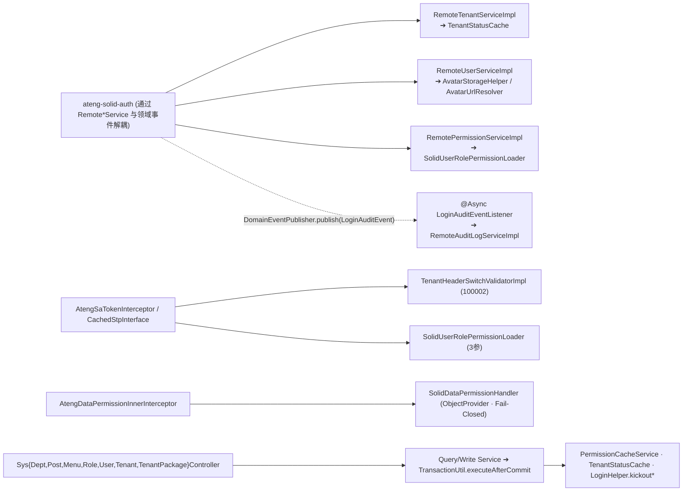

# ateng-solid-system 系统管理域核心业务实现模块

> 一句话定位：实现 `ateng-solid-system-api` 全部跨模块契约并承载组织权限、用户与 500 行并发 Excel 导入导出、5 级 `@DataScope` 数据权限引擎、可开关 SaaS 多租户与套餐、静态枚举/动态字典、系统参数、审计落库及 `db/migration/system/` Flyway 脚本（接口前缀 `/admin/system/**`）；`Spec 1 ~ Spec 4` 全量能力均已落地并通过离线单测与集成测试。

---

## 0. 对外契约、核心引擎与持久化全景速查 (`Spec 1 ~ Spec 4` 全量基线)

| 能力域 | 产物 / 入口 | 核心机制 / SPI / 配置键 | 核心输入 / 输出与边界约定 | 锚定验证测试 (`*Test.java`) |
| :--- | :--- | :--- | :--- | :--- |
| 系统配置基线 | [`SolidSystemProperties`](./src/main/java/io/github/atengk/solid/system/properties/SolidSystemProperties.java) | `ateng.solid.{init,data-scope,user,cache}` · [`SolidTenantProperties`](../ateng-solid-common/src/main/java/io/github/atengk/solid/common/properties/SolidTenantProperties.java) (`ateng.solid.tenant.*`) | 内聚超管引导、部门 IN 上限、导入治理与缓存 TTL；`toString` 屏蔽初始口令 | [`ConfigurationBaselineIntegrationTest`](../ateng-solid-bootstrap/src/test/java/io/github/atengk/solid/ConfigurationBaselineIntegrationTest.java) |
| Flyway 建表与种子 | [`V1.0.0`](./src/main/resources/db/migration/system/V1.0.0__system_init_schema.sql) · [`V1.0.1`](./src/main/resources/db/migration/system/V1.0.1__system_init_seed.sql) | 17 张表 + `< 100,000` 确定性号段 | `utf8mb4_0900_ai_ci`、无外键；内置租户 `0`、角色 `1`、部门 `100`、58 条菜单与 2 组字典（无密码哈希） | [`FlywaySchemaAndSeedIntegrationTest`](../ateng-solid-bootstrap/src/test/java/io/github/atengk/solid/FlywaySchemaAndSeedIntegrationTest.java) |
| 持久层实体与 Mapper | `io.github.atengk.solid.system.{entity,mapper}` | 17 实体（`BaseLogicEntity`/`BaseIdEntity` + `` `TenantAware<Long>` ``）+ 17 `` `AtengBaseMapper<T>` `` | `SysUser`/`SysDept` 标注 `@FieldEncrypt(deterministic = true)`；`SysUserRoleMapper#selectActiveRolesByUserId`（含 `data_scope`）与引用批量查 | [`ContactFieldEncryptPersistenceTest`](../ateng-solid-bootstrap/src/test/java/io/github/atengk/solid/ContactFieldEncryptPersistenceTest.java) |
| 5 级 `@DataScope` 数据权限引擎 | [`SolidDataPermissionHandler`](./src/main/java/io/github/atengk/solid/system/security/SolidDataPermissionHandler.java) | `DataPermissionHandler` · `ObjectProvider<Mapper>` · `ateng.solid.data-scope.max-dept-in-size` | 支持 `ALL`/`CUSTOM`/`DEPT`/`DEPT_AND_CHILD`/`SELF` 并集加括号、`ancestors` 前缀解析、超限抛 `100003` 与无角色/无部门 Fail-Closed `1 = 0` | [`SolidDataPermissionHandlerTest`](./src/test/java/io/github/atengk/solid/system/security/SolidDataPermissionHandlerTest.java) · [`DataScopeH2SqlIntegrationTest`](../ateng-solid-bootstrap/src/test/java/io/github/atengk/solid/DataScopeH2SqlIntegrationTest.java) |
| 部门管理 (`/admin/system/dept`) | [`SysDeptController`](./src/main/java/io/github/atengk/solid/system/controller/SysDeptController.java) · [`SysDeptService`](./src/main/java/io/github/atengk/solid/system/service/SysDeptService.java) · [`SysDeptQueryService`](./src/main/java/io/github/atengk/solid/system/service/SysDeptQueryService.java) | `/tree`、`GET /options` (`@SaCheckLogin`)、`GET /{id}`、`POST`、`PUT`、`PUT /{id}/status`、`DELETE /{id}` · `system:dept:*` | 祖先回溯筛选；`options` 脱敏隐去联系明文；变更上级防自环 `100001` 与 `BatchUtil` 批量级联重算 `ancestors`；子部门/用户占用阻断 `102005` | [`OrgAndRbacIntegrationTest`](../ateng-solid-bootstrap/src/test/java/io/github/atengk/solid/OrgAndRbacIntegrationTest.java) · [`OrgAndRbacMockMvcTest`](../ateng-solid-bootstrap/src/test/java/io/github/atengk/solid/OrgAndRbacMockMvcTest.java) |
| 岗位管理 (`/admin/system/post`) | [`SysPostController`](./src/main/java/io/github/atengk/solid/system/controller/SysPostController.java) · [`SysPostService`](./src/main/java/io/github/atengk/solid/system/service/SysPostService.java) | `/page`、`GET /options` (`@SaCheckLogin`)、`GET /{id}`、`POST`、`PUT`、`PUT /{id}/status`、`DELETE /{ids}` · `system:post:*` | 同租户编码/名称唯一校验 `102002`；批量删除校验 `sys_user_post`（关联未删除用户）拦截 `102005` 并点名岗位名称 | [`OrgAndRbacIntegrationTest`](../ateng-solid-bootstrap/src/test/java/io/github/atengk/solid/OrgAndRbacIntegrationTest.java) · [`OrgAndRbacMockMvcTest`](../ateng-solid-bootstrap/src/test/java/io/github/atengk/solid/OrgAndRbacMockMvcTest.java) |
| 菜单管理 (`/admin/system/menu`) | [`SysMenuController`](./src/main/java/io/github/atengk/solid/system/controller/SysMenuController.java) · [`SysMenuService`](./src/main/java/io/github/atengk/solid/system/service/SysMenuService.java) | `/tree`、`GET /{id}`、`POST`、`PUT`、`PUT /{id}/status`、`DELETE /{id}` · `system:menu:*` | 严格锁定平台默认租户 `0`（非 `0` 抛 `403`）；M/C/F 拓扑及降级守卫 `100001`；`platformOnly` 收紧级联裁剪；提交后 `clearAll()` | [`OrgAndRbacIntegrationTest`](../ateng-solid-bootstrap/src/test/java/io/github/atengk/solid/OrgAndRbacIntegrationTest.java) · [`OrgAndRbacEdgeIntegrationTest`](../ateng-solid-bootstrap/src/test/java/io/github/atengk/solid/OrgAndRbacEdgeIntegrationTest.java) |
| 角色管理 (`/admin/system/role`) | [`SysRoleController`](./src/main/java/io/github/atengk/solid/system/controller/SysRoleController.java) · [`SysRoleService`](./src/main/java/io/github/atengk/solid/system/service/SysRoleService.java) · [`SysRoleQueryService`](./src/main/java/io/github/atengk/solid/system/service/SysRoleQueryService.java) · [`RoleAuthorizationSupport`](./src/main/java/io/github/atengk/solid/system/service/RoleAuthorizationSupport.java) | `/page`、`/options` (`/menu-tree` 套餐交集)、`/{id}`、`POST`、`PUT`、`PUT /{id}/status`、`PUT /{id}/data-scope`、`DELETE /{ids}` | 禁用保留编码 `102004`；保护 `super_admin` `102007`；套餐越界 `102006`（兼容半选目录）；`CUSTOM` 至少 1 部门 `100001`；提交后 3 参 `clearRoleCache` | [`OrgAndRbacIntegrationTest`](../ateng-solid-bootstrap/src/test/java/io/github/atengk/solid/OrgAndRbacIntegrationTest.java) · [`OrgAndRbacEdgeIntegrationTest`](../ateng-solid-bootstrap/src/test/java/io/github/atengk/solid/OrgAndRbacEdgeIntegrationTest.java) |
| 静态枚举自主接管 (`/admin/system/enums`) | [`SysEnumController`](./src/main/java/io/github/atengk/solid/system/controller/SysEnumController.java) | `@SaCheckLogin` · `GET /`、`GET /{name}`、`GET /batch`、`POST /batch` · `EnumDictionaryRegistry` | 彻底关闭底座 `/api/system/enums`；覆盖全部 7 项首期 `IBaseEnum` 静态枚举（含底座 `operateType`），未命中别名抛 `404` | [`SysEnumControllerMockMvcTest`](../ateng-solid-bootstrap/src/test/java/io/github/atengk/solid/SysEnumControllerMockMvcTest.java) |
| 动态数据字典 (`/admin/system/dict`) | [`SysDictController`](./src/main/java/io/github/atengk/solid/system/controller/SysDictController.java) · [`SysDictService`](./src/main/java/io/github/atengk/solid/system/service/SysDictService.java) · [`SysDictQueryService`](./src/main/java/io/github/atengk/solid/system/service/SysDictQueryService.java) · [`DictDataCache`](./src/main/java/io/github/atengk/solid/system/support/DictDataCache.java) | `/type/*`、`/data/*`、`/data/type/{dictType}` (`@SaCheckLogin`) · `TwoLevelCacheManager` 空间 `dict` (30m) | 写操作锁定平台租户 `0`；编辑锁 `dictType`；含子项禁删 `102005`；`isDefault=1` 同事务互斥清零；停用缓空防穿透；提交后 `evict` 广播全节点淘汰 L1 | [`DictDataCacheTest`](./src/test/java/io/github/atengk/solid/system/support/DictDataCacheTest.java) · [`SysDictAndConfigIntegrationTest`](../ateng-solid-bootstrap/src/test/java/io/github/atengk/solid/SysDictAndConfigIntegrationTest.java) |
| 系统参数 (`/admin/system/config`) | [`SysConfigController`](./src/main/java/io/github/atengk/solid/system/controller/SysConfigController.java) · [`SysConfigService`](./src/main/java/io/github/atengk/solid/system/service/SysConfigService.java) · [`SysConfigCache`](./src/main/java/io/github/atengk/solid/system/support/SysConfigCache.java) | `/page`、`/{id}`、`GET /key/{configKey}` (`@SaCheckLogin`)、`POST`、`PUT`、`DELETE /{ids}` · `TwoLevelCacheManager` 空间 `config` | `configType='Y'` 禁删改键降级 `102007` 且禁业务参数 `N->Y`；`sys.user.initPassword` 过原始强口令校验；非 `0` 租户自动兜底租户 `0`；提交后广播淘汰 L1 | [`SysConfigCacheTest`](./src/test/java/io/github/atengk/solid/system/support/SysConfigCacheTest.java) · [`SysDictAndConfigIntegrationTest`](../ateng-solid-bootstrap/src/test/java/io/github/atengk/solid/SysDictAndConfigIntegrationTest.java) |
| 操作审计落库与只读日志 (`/admin/system/log`) | [`SolidOperateLogStorageProvider`](./src/main/java/io/github/atengk/solid/system/audit/SolidOperateLogStorageProvider.java) · [`SysLogController`](./src/main/java/io/github/atengk/solid/system/controller/SysLogController.java) · [`SysLogQueryService`](./src/main/java/io/github/atengk/solid/system/service/SysLogQueryService.java) | `OperateLogStorageProvider` · `/oper/page`、`/oper/{id}`、`/login/page` (`system:{oper,login}-log:list`) | 异步线程脱离 `LoginHelper` 主键回查账号与租户 `0` 超管，脱敏堆栈 SQL 落库；查询端点严格只读倒序与跨租户隔离 | [`SolidOperateLogStorageProviderTest`](./src/test/java/io/github/atengk/solid/system/audit/SolidOperateLogStorageProviderTest.java) · [`AuditLogIntegrationAndMockMvcTest`](../ateng-solid-bootstrap/src/test/java/io/github/atengk/solid/AuditLogIntegrationAndMockMvcTest.java) |
| 超管启动引导器 | [`SuperAdminBootstrapper`](./src/main/java/io/github/atengk/solid/system/bootstrap/SuperAdminBootstrapper.java) | `ApplicationRunner` · `ateng:solid:init:super-admin:lock` (30s) | `role_id=1` 绑定判重跳过；外部强口令校验 Fail-Fast；留空生成 16 位无歧义随机口令；`DuplicateKeyException` 事务外复核 | [`SuperAdminBootstrapperIntegrationTest`](../ateng-solid-bootstrap/src/test/java/io/github/atengk/solid/SuperAdminBootstrapperIntegrationTest.java) |
| 租户服务、零漂移缓存与切头校验 | [`RemoteTenantServiceImpl`](./src/main/java/io/github/atengk/solid/system/service/remote/RemoteTenantServiceImpl.java) · [`TenantStatusCache`](./src/main/java/io/github/atengk/solid/system/support/TenantStatusCache.java) · [`TenantHeaderSwitchValidatorImpl`](./src/main/java/io/github/atengk/solid/system/security/TenantHeaderSwitchValidatorImpl.java) | `RemoteTenantService` · `TenantHeaderSwitchValidator` · `RedisCacheTemplate` 键 `tenant:status:{tenantId}` (TTL 60s) | 纯 L2 强一致 + Redisson 防击穿 + 负向哨兵 + 本地 10,000 上限降级；读时 0 秒过期截断；单租户禁切与异常租户抛 `100002` 且不注销超管会话 | [`TenantStatusCacheTest`](./src/test/java/io/github/atengk/solid/system/support/TenantStatusCacheTest.java) · [`RemoteServicesIntegrationTest`](../ateng-solid-bootstrap/src/test/java/io/github/atengk/solid/RemoteServicesIntegrationTest.java) |
| 权限服务与加载器 SPI | [`RemotePermissionServiceImpl`](./src/main/java/io/github/atengk/solid/system/service/remote/RemotePermissionServiceImpl.java) · [`SolidUserRolePermissionLoader`](./src/main/java/io/github/atengk/solid/system/security/SolidUserRolePermissionLoader.java) | `RemotePermissionService` · `UserRolePermissionLoader` 3 参重载 | 隔离非 `admin` 体系；停用祖先级联剪枝、`platform_only=1` 拦截、`!tenantEnabled` 隐藏多租户目录与空 `M` 裁剪；超管返回 `["*:*:*"]` | [`RemoteServicesIntegrationTest`](../ateng-solid-bootstrap/src/test/java/io/github/atengk/solid/RemoteServicesIntegrationTest.java) |
| 用户远程服务与头像引擎 | [`RemoteUserServiceImpl`](./src/main/java/io/github/atengk/solid/system/service/remote/RemoteUserServiceImpl.java) · [`AvatarStorageHelper`](./src/main/java/io/github/atengk/solid/system/support/AvatarStorageHelper.java) · [`AvatarUrlResolver`](./src/main/java/io/github/atengk/solid/system/support/AvatarUrlResolver.java) | `RemoteUserService` · `StorageOperations` · `StorageGuard` | 超管跨租户切换摘要解析；空白转 `NULL`/冲突抛 `102002`；头像强魔数守卫 `100004` + 回滚删除 + 2h `inline` 预签名 | [`AvatarUrlResolverTest`](./src/test/java/io/github/atengk/solid/system/support/AvatarUrlResolverTest.java) · [`RemoteServicesIntegrationTest`](../ateng-solid-bootstrap/src/test/java/io/github/atengk/solid/RemoteServicesIntegrationTest.java) |
| 联系字段确定性加密与可选 Redis 开关 | [`ContactFieldCrypto`](./src/main/java/io/github/atengk/solid/system/support/ContactFieldCrypto.java) · [`RedisActivationResolver`](./src/main/java/io/github/atengk/solid/system/support/RedisActivationResolver.java) | `ateng.boot.mybatis-plus.crypto.secret-key` · `ateng.boot.redis.enabled` | 空白转 `null`/邮箱小写归一化与单值批量确定性加密；`redis.enabled=false` 时统一抑制误连 `localhost:6379` | [`ContactFieldCryptoTest`](./src/test/java/io/github/atengk/solid/system/support/ContactFieldCryptoTest.java) · [`ContactFieldEncryptPersistenceTest`](../ateng-solid-bootstrap/src/test/java/io/github/atengk/solid/ContactFieldEncryptPersistenceTest.java) |
| 登录审计落库与异步监听 | [`RemoteAuditLogServiceImpl`](./src/main/java/io/github/atengk/solid/system/service/remote/RemoteAuditLogServiceImpl.java) · [`LoginAuditEventListener`](./src/main/java/io/github/atengk/solid/system/listener/LoginAuditEventListener.java) | `RemoteAuditLogService` · `@Async @EventListener` (`LoginAuditEvent`) | 按 `eventId` 执行 24h 幂等去重；解析浏览器/OS；仅登录成功同步回写最近登录 IP 与时间 | [`RemoteServicesIntegrationTest`](../ateng-solid-bootstrap/src/test/java/io/github/atengk/solid/RemoteServicesIntegrationTest.java) |
| 用户管理与配额守卫 (`/admin/system/user`) | [`SysUserController`](./src/main/java/io/github/atengk/solid/system/controller/SysUserController.java) · [`SysUserService`](./src/main/java/io/github/atengk/solid/system/service/SysUserService.java) · [`SysUserQueryService`](./src/main/java/io/github/atengk/solid/system/service/SysUserQueryService.java) · [`TenantQuotaGuard`](./src/main/java/io/github/atengk/solid/system/support/TenantQuotaGuard.java) · [`UserRelationSupport`](./src/main/java/io/github/atengk/solid/system/support/UserRelationSupport.java) | `/page`（部门子树 + 密文手机号精确查）、`/options`（`@SaCheckLogin`）、`/{id}`、`POST`、`PUT`、`/{id}/status`、`/{id}/reset-password`、`DELETE /{ids}` · `system:user:*` | 受 5 级 `@DataScope` 读写隔离；事务外 `PasswordUtil.hash` + 悲观行锁 `PessimisticLockUtil.forUpdate` 防超卖（`102006`）；内置超管与自身禁停删/降权（`102007`）；提交后清理权限缓存并强退会话 | [`SysUserCrudAndDataScopeTest`](../ateng-solid-bootstrap/src/test/java/io/github/atengk/solid/SysUserCrudAndDataScopeTest.java) |
| 用户 Excel 导入导出 (`/admin/system/user/{import,export}`) | [`SysUserImportExportController`](./src/main/java/io/github/atengk/solid/system/controller/SysUserImportExportController.java) · [`SysUserExcelService`](./src/main/java/io/github/atengk/solid/system/service/SysUserExcelService.java) · [`UserImportValidator`](./src/main/java/io/github/atengk/solid/system/service/UserImportValidator.java) · [`UserBatchPersistHelper`](./src/main/java/io/github/atengk/solid/system/service/UserBatchPersistHelper.java) · [`ImportFeedbackStore`](./src/main/java/io/github/atengk/solid/system/support/ImportFeedbackStore.java) | `/import/template`、`POST /import` (`@RateLimiter` USER `5/60s`)、`GET /import/feedback/{feedbackToken}`、`POST /export` (`@RateLimiter` USER `10/60s`) · `ateng.solid.user.*` | 9 列模板（`UserImportDTO`）；三段式并发流水（无事务全量校验 ➔ `Semaphore(2)` + `password-hash` 并行哈希 ➔ 短事务批插）；`ImportResultVO` 剔除 `rowData` 与 15m 归属隔离批注下载；9 列流式 `@ExcelSensitive` 导出 | [`ImportFeedbackStoreTest`](./src/test/java/io/github/atengk/solid/system/support/ImportFeedbackStoreTest.java) · [`SysUserExcelImportIntegrationTest`](../ateng-solid-bootstrap/src/test/java/io/github/atengk/solid/SysUserExcelImportIntegrationTest.java) · [`RateLimiterMockMvcTest`](../ateng-solid-bootstrap/src/test/java/io/github/atengk/solid/RateLimiterMockMvcTest.java) |
| 可开关 SaaS 租户与套餐 (`/admin/system/{tenant,tenant-package}`) | [`SysTenantController`](./src/main/java/io/github/atengk/solid/system/controller/SysTenantController.java) · [`SysTenantService`](./src/main/java/io/github/atengk/solid/system/service/SysTenantService.java) · [`TenantInitializationSupport`](./src/main/java/io/github/atengk/solid/system/support/TenantInitializationSupport.java) · [`SysTenantPackageController`](./src/main/java/io/github/atengk/solid/system/controller/SysTenantPackageController.java) · [`SysTenantPackageService`](./src/main/java/io/github/atengk/solid/system/service/SysTenantPackageService.java) · [`TenantPackageMenuSyncSupport`](./src/main/java/io/github/atengk/solid/system/support/TenantPackageMenuSyncSupport.java) | `/tenant/{page,options,{id},{id}/status,{ids}}` · `/tenant-package/{page,options,shrink-preview,{id},{id}/status,{ids}}` | 仅 `tenant.enabled=true` 且平台租户 `0` 可维护（否则抛 `403`）；4 步原子初始化（`saveParams=false`）；保护租户 `0`（`102003`）；套餐拦截 `platform_only`/停用菜单（`102006`）与绑定禁删（`102005`），缩减原子裁剪跨租户 `sys_role_menu` | [`SysTenantToggleGuardTest`](./src/test/java/io/github/atengk/solid/system/support/SysTenantToggleGuardTest.java) · [`TenantAndPackageIntegrationTest`](../ateng-solid-bootstrap/src/test/java/io/github/atengk/solid/TenantAndPackageIntegrationTest.java) |

---

## 1. 模块定位与依赖边界

- **依赖拓扑约束**：本模块实现 `ateng-solid-system-api` 契约，单向依赖 `ateng-solid-common` 与 `ateng-solid-system-api`，**严禁**反向依赖 `ateng-solid-auth`；对外 Controller 严禁暴露持久层 `Entity`，`Service` 层严禁依赖 `jakarta.servlet.*`。
- **持久层继承基类矩阵**：
  - 10 张核心主表继承 `BaseLogicEntity`（`deleted BIGINT NOT NULL DEFAULT 0`，逻辑删除回填自身雪花主键 `id`）：`SysTenant`、`SysTenantPackage`、`SysMenu`、`SysDictType`、`SysDictData`、`SysDept`、`SysPost`、`SysRole`、`SysUser`、`SysConfig`；
  - 7 张关联与只追加审计日志表继承 `BaseIdEntity`：`SysTenantPackageMenu`、`SysUserRole`、`SysUserPost`、`SysRoleMenu`、`SysRoleDept`、`SysOperLog`、`SysLoginLog`；
  - 上述 11 张租户隔离表统一实现 `` `TenantAware<Long>` ``，17 个 Mapper 统一继承 `` `AtengBaseMapper<T>` ``。

---

## 2. 核心架构与数据流转



- **动态路由菜单四重剪枝顺序**：归属租户校验（非超管禁跨租户）➔ 非平台租户状态及激活套餐校验 ➔ 全量树自顶向下级联剪枝（停用祖先、`platform_only=1`、单租户模式隐藏 `3000` 多租户治理目录）➔ 剥离 `F` 按钮并裁剪空 `M` 目录。

---

## 3. 核心业务域实现（配置 · 调用 · 边界闭环）

### 3.1 平台超管启动引导 (`SuperAdminBootstrapper`)

**1. 专属配置片段**

```yaml
ateng:
  solid:
    init:
      enabled: true                  # 是否启用首次启动自动检查并引导创建平台超级管理员
      super-admin-username: superadmin # 平台默认租户 0 内超管账号
      super-admin-nickname: 超级管理员   # 展示昵称
      super-admin-password: ${SOLID_INIT_SUPER_ADMIN_PASSWORD:} # 留空首次建号生成 16 位强随机口令
```

**2. 启动引导核心调用流**

```java
// Spring Boot 启动完成后按 ApplicationRunner 自动调度（无需手工调用）
// 1. 以 role_id = 1（super_admin）绑定关系判重：已存在有效超管即记录 INFO 日志幂等跳过（改名亦不重插）
// 2. 启用 Redis 时抢占 30s 锁 ateng:solid:init:super-admin:lock（Lua 比对令牌原子释放）
// 3. TransactionTemplate 单短事务写 sys_user(tenant_id=0, dept_id=100, pwd_update_time=null) 与 sys_user_role(role_id=1)
```

**3. 边界与防御**
- 外部注入非空口令须通过 `PasswordPolicyValidator` 校验，不合格立即抛出 `IllegalStateException` 且**严禁日志或异常打印原始口令**；留空自动生成不含 `0/O/o/1/I/l` 的 16 位强口令且仅在首次创建时通过独立 `WARN` Banner 输出一次。
- 发生 `DuplicateKeyException` 时在事务回滚之外二次复查绑定状态：并发超管胜出则静默跳过，普通账号占用默认名则 Fail-Fast 抛 `IllegalStateException`。

### 3.2 多租户缓存、切换防越权与动态路由

**1. 专属配置片段**

```yaml
ateng:
  boot:
    satoken:
      primary-login-type: admin
      super-admin-roles: [super_admin]
      tenant:
        header-name: X-Tenant-Id
        allow-anonymous-header: false
        allow-super-admin-switch: true
        platform-tenant-ids: ["0"]
  solid:
    tenant:
      enabled: false          # false=单租户开箱模式；true=开启 SaaS 行级隔离与跨租户切换
      status-cache-ttl: 60s   # 缓存有效期；读取时仍实时校对 expireTime 实现 0 秒截断
```

**2. 契约调用示例**

```java
// 1. 认证前/切租户校验：缓存命中紧凑 JSON 后实时执行 TenantAuthDTO#isAvailableAt(LocalDateTime.now())
boolean available = remoteTenantService.isTenantAvailable(targetTenantId);

// 2. 登录工作台与动态路由拉取（按生效视角自动裁剪平台专属、未入选套餐与停用目录）
List<RouteMenuDTO> menus = remotePermissionService.getRouteMenusByUserId(
        ownerTenantId, effectiveTenantId, userId, isSuperAdmin, tenantProperties.isEnabled()
);
```

**3. 边界与防御**
- `TenantStatusCache` 经由 `AdaptiveRedisSupport` 委派纯 L2 `RedisCacheTemplate`（相对键 `tenant:status:{tenantId}`），使用 `__ATENG_CACHE_NULL__` 空哨兵防缓存穿透并具备 Redisson 防击穿互斥与 Jitter TTL；当 `ateng.boot.redis.enabled=false` 或 Redis 不可达时自动降级为容量上限 `10,000` 的进程内 `ConcurrentLruCache`（`RedisActivationResolver` 暂保留至存量调用方全量收口）。
- `TenantHeaderSwitchValidatorImpl` 在单租户模式下拒绝一切非 `0` 切换请求，在多租户模式下拦截非法格式、匿名头与不可用租户并抛出 `100002`（`INVALID_TENANT_SWITCH`），**绝不调用注销接口**，保护超管 `"0"` 会话在线。

### 3.3 联系字段加密、个人资料维护与头像预览签发

**1. 专属配置片段**

```yaml
ateng:
  boot:
    mybatis-plus:
      crypto:
        secret-key: ${SOLID_CRYPTO_SECRET_KEY:YOUR_CRYPTO_SECRET_KEY}
    storage:
      type: s3
      guard:
        enabled: true
        strict-magic-check: true
        allowed-extensions: [jpg, jpeg, png, webp]
        max-file-size: 2MB
```

**2. 契约调用示例**

```java
// 1. 联系字段归一化写入与 LambdaUpdateWrapper 清空绑定
remoteUserService.updatePersonalProfile(tenantId, userId, UpdatePersonalProfileCommand.builder()
        .nickname("平台运营").phone("13800138000").email("ops@example.com").gender("1").build());

// 2. 头像安全上传（返回相对对象键与 2h inline 预签名地址，Storage 关闭时自动降级对象键）
AvatarUploadDTO uploaded = remoteUserService.uploadAvatar(tenantId, userId, cmd);
String previewUrl = avatarUrlResolver.resolve(uploaded.getObjectPath());
```

**3. 边界与防御**
- `SysUser.phone`/`email` 严禁发起 `LIKE` 模糊检索或 `ORDER BY`；`LambdaQueryWrapper` 传入 `ContactFieldCrypto.normalize*`，`QueryWrapper` 与 `LambdaUpdateWrapper#set` 传入 `ContactFieldCrypto.encrypt*ForQuery`；个人资料同租户撞手机号或小写归一化撞邮箱抛 `102002`。
- `RemoteUserServiceImpl#uploadAvatar` 由 `AvatarStorageHelper` 前置执行扩展名、体积与二进制魔数守卫（拒接抛 `100004`）；随后于单事务内调用 `uploadWithRollbackDelete` 落盘相对对象键，并在提交后注册 `deleteAfterCommit` 安全删旧非外链键。
- `RemoteUserServiceImpl#getAdminProfile` 仅放行平台已绑定 `super_admin` 角色的账号按切换后 `effectiveTenantId` 查摘要，普通账号跨租户一概拒绝并抛 `102001`。

### 3.4 异步登录审计与领域事件监听

**1. 专属配置片段**

```yaml
spring:
  threads:
    virtual:
      enabled: true   # 异步事件监听（@Async）自动依托虚拟线程及 AsyncContext 快照透传 traceId 与租户上下文
```

**2. 领域事件与落库调用示例**

```java
// 认证域发布标准领域事件（无需直接依赖 system 模块）
domainEventPublisher.publish(LoginAuditEvent.builder()
        .tenantId(tenantId).traceId(traceId).userId(userId).username("admin")
        .loginType("admin").clientIp("10.0.0.12").userAgent(userAgent)
        .status(LogStatusEnum.SUCCESS.getCode()).message("登录成功").build());
```

**3. 边界与防御**
- `LoginAuditEventListener` 对异步执行异常记 `error` 日志并隔离，绝不因审计故障阻塞登录或登出响应。
- `RemoteAuditLogServiceImpl` 通过 `eventId` 实施 24 小时幂等去重（DB 失败回滚释放去重标记），安全截断超长列防止 SQL 截断报错，并仅在认证成功（`status = 0`）且 `userId != null` 时更新用户最近登录 IP 与时间。

### 3.5 5 级 `@DataScope` 数据权限引擎 (`SolidDataPermissionHandler`)

**1. 专属配置片段**

```yaml
ateng:
  boot:
    mybatis-plus:
      data-permission:
        enabled: true
        failure-strategy: DENY_ALL   # 数据权限解析失败严格阻断访问
  solid:
    data-scope:
      max-dept-in-size: 1000         # DEPT_AND_CHILD / 并集可见部门 IN 集合安全上限（超限抛 100003）
```

**2. 注解绑定与策略示例**

```java
// 用户联查部门树标准驱动表别名声明（本人列为 u.id）
@DataScope(alias = "u", deptColumn = "dept_id", userColumn = "id")
List<Long> selectVisibleUserIds();
```

**3. 边界与防御**
- 处理器构造器全部通过 `ObjectProvider<Mapper>` 延迟解析，打破 `SqlSessionFactory -> MybatisPlusInterceptor -> DataPermissionHandler -> Mapper` 启动期循环依赖；内部全部检索包裹在 `DataPermissionContextHolder.runWithoutPermission` + `TenantContextHolder.runWithTenant` 内严防自拦截递归与跨租户越权。
- 5 级策略按多角色并集解析：`ALL` 任一命中即放行（返回 `null`，仍受 `tenant_id` 与 `deleted = 0` 保护）；`DEPT_AND_CHILD` 通过精确 `ancestors` 前缀条件（`ancestors = '{prefix}' OR ancestors LIKE '{prefix},%'`）服务端预解析，禁用 `FIND_IN_SET`；`SELF` 按 `userColumn = "create_by"` 走 `StringValue`，其余走 `LongValue`；部门 `IN` 与 `SELF` 并存时显式包裹 `ParenthesedExpressionList(OrExpression)`；无有效角色或无可用部门/本人权限严格 Fail-Closed 返回 `1 = 0`。

### 3.6 组织架构（部门/岗位）与权限树（菜单/角色）闭环

**1. 专属配置与控制器路由总览**

```yaml
ateng:
  solid:
    tenant:
      enabled: false   # false 时 /admin/system/role/menu-tree 与权限树同步隐藏 3000 多租户治理菜单
```

```
GET/POST/PUT/DELETE  /admin/system/dept/{tree,options,{id},{id}/status}
GET/POST/PUT/DELETE  /admin/system/post/{page,options,{id},{id}/status,{ids}}
GET/POST/PUT/DELETE  /admin/system/menu/{tree,{id},{id}/status}      # 严格锁定平台租户 0
GET/POST/PUT/DELETE  /admin/system/role/{page,options,menu-tree,{id},{id}/status,{id}/data-scope,{ids}}
```

**2. 核心写路径与事务提交后缓存联动示例**

```json
PUT /admin/system/role/2001/data-scope
{
  "dataScope": 2,
  "deptCheckStrictly": false,
  "deptIds": ["100", "101"]
}
```

**3. 边界与防御**
- **部门（`SysDeptService` / `SysDeptQueryService`）**：变更上级严防选自身或子孙（`100001`），事务内调用 `BatchUtil.updateBatch` 级联重算子孙 `ancestors`；联系人更新通过 `LambdaUpdateWrapper#set` 显式传 `ContactFieldCrypto.encrypt*ForQuery` 支持置 `NULL` 清空；`/options` 下拉树屏蔽手机号与邮箱；停用含未停用子部门或删除含子部门/活跃用户一律抛出 `102005`（用户数查询关闭 `@DataScope` 防限权误删）。
- **岗位（`SysPostService`）**：同租户下 `postCode` 与 `postName` 唯一（`102002`）；批量删除经 `SysUserPostMapper.selectReferencedPostIds`（关联 `u.deleted = 0`）校验，任一岗位被活跃用户引用即整批拦截（`102005`）并点名具体岗位名称。
- **菜单（`SysMenuService`）**：全部读写接口强制校验平台租户 `0`（非 `0` 抛 `403`）；严格校验 `M`/`C`/`F` 拓扑、`perms` 三段式正则、外链 `^https?://.+`、路由组件 `name` 全树唯一（`102002`）与节点降级冲突（`100001`）；`platformOnly` 由 `false` 收紧为 `true` 时级联收紧子树并裁剪非平台绑定；删停/改写成功后于 `TransactionUtil.executeAfterCommit` 触发 `permissionCacheService.clearAll()`。
- **角色（`SysRoleService` / `SysRoleQueryService`）**：禁用保留编码 `super_admin`/`admin`（`102004`）；平台内置 `super_admin` 角色禁止改停删与改数据范围（`102007`）；`/options` 非平台超管视角隐藏 `super_admin`；普通租户 `/menu-tree` 与 `createRole`/`updateRole` 严格校验套餐边界及 `platformOnly=false`（越界抛 `102006`，并兼容 `menu_check_strictly=0` 半选套餐回传的父目录半选节点）；变更菜单/状态/删除提交后调用 3 参 `clearRoleCache("admin", tenantId, roleKey)`，若同时修改 `roleKey` 则联动清理绑定用户的 `user-roles` 缓存。

### 3.7 静态枚举接管、动态字典与系统参数多租户缓存

**1. 专属配置片段**

```yaml
ateng:
  boot:
    web:
      enum:
        enabled: true
        endpoint-enabled: false # 彻底关闭底座 /api/system/enums，交由 SysEnumController 管控
        scan-packages:
          - io.github.atengk.solid
          - io.github.atengk.boot.core.audit # 扫描接入 OperateTypeEnum
  solid:
    cache:
      dict-ttl: 30m
      config-ttl: 30m
```

**2. 多租户参数兜底与静态枚举调用示例**

```java
// 1. 静态枚举单别名/全量查询（受 @SaCheckLogin 保护，未命中抛出 404）
Result<List<OptionItem<Object>>> operateTypes = sysEnumController.getByName("operateType");

// 2. 系统参数读取（非 0 租户未命中时自动在 TenantContextHolder.runWithTenant(0L, ...) 下兜底平台全局值）
String initPwd = sysConfigService.getConfigValue(tenantId, "sys.user.initPassword");
```

**3. 边界与防御**
- **两级与自适应降级缓存（`AdaptiveRedisSupport` / `DictDataCache` / `SysConfigCache`）**：Redis 激活时委派 `TwoLevelCacheManager` 管理 `dict`/`config` 空间（`Caffeine` L1 + Redis L2 + 跨节点 Pub/Sub 失效协同），`Redis` 读写与业务回源异常严格解耦，避免数据库回源报错被误降级重复执行；无 Redis 或故障时由 `AdaptiveRedisSupport` 降级 `ConcurrentLruCache(10_000)`；全部写操作后置于 `TransactionUtil.executeAfterCommit` 精准驱逐，封装类型安全载荷哨兵防集合泛型擦除与空值穿透。
- **平台字典锁与系统参数保护**：字典类型/明细管理写操作严格校验平台租户 `0`，编辑锁定 `dictType` 不可改，含未删除子项阻断删类型（`102005`），局部更新未传 `tagType` 时保留原有样式；系统内置参数（`configType='Y'`）禁删、禁改键名与禁降级（`102007`），且业务自建参数创建后禁止编辑升格为 `'Y'`，`sys.user.initPassword` 基于未裁剪原始值执行 `PasswordPolicyValidator` 强口令校验。

### 3.8 操作审计异步落库与只读审计查询

**1. 专属配置片段**

```yaml
spring:
  threads:
    virtual:
      enabled: true   # @OperateLog 切面在异步工作线程委托 OperateLogStorageProvider 落库
```

**2. 异步线程上下文安全落库流（提取自 [`SolidOperateLogStorageProvider`](./src/main/java/io/github/atengk/solid/system/audit/SolidOperateLogStorageProvider.java)）**

```java
// 严禁在异步线程调 LoginHelper.getLoginUser()，严格依据 model 租户与用户主键回查账号并回退平台租户 0
String resolvedUserName = resolveUserName(effectiveTenantId, userId, model.getUserName());
entity.setErrorMsg(SystemContextSupport.sanitizeAuditErrorMsg(model.getErrorMsg()));
TenantContextHolder.runWithTenant(effectiveTenantId, () -> sysOperLogMapper.insert(entity));
```

**3. 边界与防御**
- **防崩溃与敏感堆栈截断**：`SystemContextSupport#sanitizeAuditErrorMsg` 对包含 Java 异常类名/堆栈与原始 SQL 的错误信息替换为安全提示，长字段（`requestParams`、`responseResult`、`extraJson`）截断上限 `16,000` 字符防止超过 `TEXT` 列阈值导致审计丢失，落库异常就地记录并隔离绝不波及业务请求。
- **严格只读分页查询**：`SysLogController` 零增删改端点（`DELETE` 等返回 `405`），按工作租户严格隔离、起止时间逆序检验（`100001`）与发生时间/主键倒序分页输出。

### 3.9 用户管理 CRUD、悲观行锁配额守卫与三段式 500 行 Excel 导入导出

**1. 专属配置与控制器路由总览**

```yaml
ateng:
  solid:
    user:
      import-max-rows: 500        # 单次 Excel 批量导入允许最大数据行数（超限抛 100005）
      max-concurrent-imports: 2   # 并发导入信号量许可数（排队超 3s 抛 429）
      import-feedback-ttl: 15m    # 标红批注工作簿暂存 TTL
```

```
GET/POST/PUT/DELETE  /admin/system/user/{page,options,{id},{id}/status,{id}/reset-password,{ids}}
GET/POST             /admin/system/user/{import/template,import,import/feedback/{feedbackToken},export}
```

**2. 三段式并发导入流水线（提取自 [`SysUserExcelService`](./src/main/java/io/github/atengk/solid/system/service/SysUserExcelService.java)）**

```java
// 1. 阶段 1（无事务）：全量校验并统计总数据行数，任一出错立即渲染标红批注后返回，绝不触发耗时 PBKDF2 计算
ValidationOutcome outcome = userImportValidator.validate(
        tenantId, allowSuperAdminAssign, readResult, importMaxRows
);
if (!outcome.errors().isEmpty()) {
    return buildErrorFeedbackResult(
            tenantId, operatorUserId, originalFilename, fileBytes, outcome.totalCount(), outcome.errors()
    );
}

// 2. 阶段 2（无事务）：先读取强口令，再通过信号量限流与有界平台池并行计算每行独立随机盐哈希
String initPassword = userContactAndDictSupport.resolveAndValidatePassword(tenantId, null);
List<PreparedImportUser> preparedUsers = computeHashesInParallel(outcome.validRows(), initPassword);

// 3. 阶段 3（短事务）：加租户悲观行锁复核配额并批量落库
int successCount = userBatchPersistHelper.persistBatch(tenantId, preparedUsers);
```

**3. 边界与防御**
- **5 级 `@DataScope` 读写隔离与内置保护（`SysUserService` / `SysUserQueryService`）**：`/page` 展开所选部门子树集合并用确定性密文 `ContactFieldCrypto.encryptPhoneForQuery` 精确检索 11 位手机号；`/options` 面向部门负责人等选人场景以 `@SaCheckLogin` 放行并屏蔽明文联系方式与密码；修改/切换状态/重置密码/删除先经 `selectUserByIdWithDataScope` 校验操作者可见范围（未命中抛 `102001`），并严格阻断停用/删除平台内置超管与当前登录用户本人、阻止非本人重置超管密码及防止用户自编辑剥离自身绑定角色或分配 `super_admin`（`102007` / `102006`）。
- **悲观行锁防超卖（`TenantQuotaGuard`）**：新增用户、停用转启用用户与批量导入阶段 3 必须在活跃写事务内调用 `assertQuotaAvailable`，通过 `PessimisticLockUtil.forUpdate` 锁定 `sys_tenant` 目标行后再统计租户现有用户数与 `account_count`（`<= 0` 如 `-1` 表示不限，超额抛 `102006`）；新增用户、`resetPassword` 与导入接口均于事务外调用 `PasswordUtil.hash`，且审计注解显式声明 `saveParams = false`、`exportUsers` 声明 `saveResult = false`。
- **三段式导入与双模批注隔离（`UserImportValidator` / `ImportFeedbackStore`）**：上传文件严格限制 `.xlsx` 且 `<= 2MB`；阶段 1 一次性装载账号/密文手机/密文邮箱集合、部门同名与 `/` 全路径索引（`ImportDeptPathResolver`）、岗位/角色编码字典与动态性别字典 `sys_user_gender` 消除循环 N+1，并实施无锁配额预检 `checkQuotaPreview`；存在错误时剥离 `ExcelErrorRow.rowData` 返回 `ImportResultVO` 并将标红批注工作簿暂存为 Redis `meta`/`bin` 双 Key（或本地 50 条 LRU 上限，4MB 上限），下载端点强制核验 `tenantId` 与 `operatorUserId` 归属（越权 `403`、不存在/过期 `404`）；阶段 2 使用 `Semaphore`（默认 `2`，超时 `3s` 抛 `429`）+ `password-hash` 平台线程池（等待上限 `90s`）；流式导出通过 `@ExcelSensitive` 自动脱敏手机与邮箱并排除密码列。

### 3.10 可开关 SaaS 多租户 4 步初始化与租户套餐跨租户裁剪

**1. 专属开关与控制器路由总览**

```yaml
ateng:
  solid:
    tenant:
      enabled: false          # false 时 TenantController 与 TenantPackageController 全量接口统一抛出 403
      status-cache-ttl: 60s   # 停/删/更新租户后于 TransactionUtil.executeAfterCommit 精准驱逐缓存
```

```
GET/POST/PUT/DELETE  /admin/system/tenant/{page,options,{id},{id}/status,{ids}}
GET/POST/PUT/DELETE  /admin/system/tenant-package/{page,options,shrink-preview,{id},{id}/status,{ids}}
```

**2. 4 步原子初始化短事务（提取自 [`TenantInitializationSupport`](./src/main/java/io/github/atengk/solid/system/support/TenantInitializationSupport.java)）**

```java
// 1. 插入 sys_tenant 并获取新分配的雪花租户主键
// 2. 切入新租户上下文创建根部门
// 3. 创建默认 tenant_admin 角色并写入套餐有效非平台专属菜单授权
// 4. 创建初始租户管理员账号（pwd_update_time 为空）并绑定角色
TenantContextHolder.runWithTenant(newTenantId, () -> {
    SysDept rootDept = insertRootDept(newTenantId, command.tenantName());
    SysRole tenantAdminRole = insertTenantAdminRole(newTenantId);
    insertRoleMenus(newTenantId, tenantAdminRole.getId(), command.packageMenuIds());
    insertTenantAdminUser(newTenantId, rootDept.getId(), tenantAdminRole.getId(), command);
});
```

**3. 边界与防御**
- **双开关与平台租户 `0` 双重门禁**：`SystemContextSupport#requireMultiTenantPlatformAccess` 与 `requirePlatformSuperAdminSwitchAccess` 强制要求 `ateng.solid.tenant.enabled = true` 且未切出平台默认租户 `0`（`/options` 同步校验 `ownerTenantId == "0"` 且具备 `super_admin` 角色），单租户关闭态或跨租户观察态访问一律拒绝 `403`；停用或删除平台内置 `0` 号租户、篡改其 `tenantCode`/`packageId`/`expireTime`/`accountCount` 一律触发 `102003`（`0` 号仅允许维护 `tenantName` 与 `remark`），普通租户建后锁定只读 `tenantCode`。
- **零明文泄漏与停删会话强退**：`SysTenantController#create` 标注 `@OperateLog(..., saveParams = false)`，在事务外先通过 `PasswordPolicyValidator` 校验与 `PasswordUtil.hash` 计算后进入短事务落库 `CreateTenantVO`；租户被停用或删除时，在 `TransactionUtil.executeAfterCommit` 驱逐 `TenantStatusCache` 并分页扫描 `LoginHelper.searchOnlineUserPage` 对该租户全部在线 `admin` 会话执行 `kickoutByTokenForTenant`。
- **租户软删除逻辑隔离归档与 DBA 清理指引**：`SysTenantService#deleteTenants` 仅对 `sys_tenant` 执行逻辑删除（不级联更新其名下租户隔离表 `deleted` 标记），以防止大租户删除触发多表级联长事务锁表并保留不可变审计流水（`sys_oper_log`、`sys_login_log`）关联可追溯性；`sys_tenant` 软删除后，借由缓存实时驱逐、全员会话强退、登录/可用性拦截（`101005`）与超管 `X-Tenant-Id` 校验（`100002`）形成访问闭环。运维或 DBA 如需对已软删除的历史租户执行存储回收，可基于 `sys_tenant.deleted <> 0` 筛选目标 `tenant_id` 后，分批物理归档/清理 `sys_dept`、`sys_post`、`sys_user`、`sys_role`、`sys_config` 及 4 张关联表（`sys_user_role`、`sys_user_post`、`sys_role_menu`、`sys_role_dept`），审计流水表（`sys_oper_log`、`sys_login_log`）须保留并按合规留存策略单独转储。
- **租户套餐防越权与跨租户原子裁剪（`SysTenantPackageService` / `TenantPackageMenuSyncSupport`）**：新增/编辑套餐严禁勾选 `platform_only = true` 或停用态菜单（越界抛 `102006`）；删除套餐前通过 `SysTenantMapper#selectTenantCountsByPackageIds` 校核引用，仍被未删除租户绑定即整批拦截（`102005`）；停用套餐不影响已绑定存量租户继续使用，仅禁止新租户或换套餐新选；编辑套餐缩减菜单或租户更换为更窄套餐时，`POST /shrink-preview` 提供影响租户与移除菜单标题只读预览，确认保存则在事务内调用 `pruneRoleMenusForTenants`（自动向上保留半选态活跃祖先目录 `M` 防误删半选授权），随后提交后触发 `permissionCacheService.clearAll()` 全清权限缓存。

---

## 4. 扩展点 (SPI) 与非功能防线

| 扩展点 / 防线 | 实现类 | 核心职责与并发/安全约束 |
| :--- | :--- | :--- |
| 底座 `TenantHeaderSwitchValidator` | [`TenantHeaderSwitchValidatorImpl`](./src/main/java/io/github/atengk/solid/system/security/TenantHeaderSwitchValidatorImpl.java) | 校验 `X-Tenant-Id` 与 `ateng.solid.tenant.enabled`，拒绝非法切换抛 `100002` |
| 底座 `UserRolePermissionLoader` | [`SolidUserRolePermissionLoader`](./src/main/java/io/github/atengk/solid/system/security/SolidUserRolePermissionLoader.java) | 实现单参/双参/三参重载，隔离 `admin` 体系并桥接 `CachedStpInterface` 二级缓存 |
| 底座 `DataPermissionHandler` | [`SolidDataPermissionHandler`](./src/main/java/io/github/atengk/solid/system/security/SolidDataPermissionHandler.java) | 5 级数据权限 SQL AST 改写，`ObjectProvider` 解耦 Bean 循环，Fail-Closed `1 = 0` |
| 底座 `OperateLogStorageProvider` | [`SolidOperateLogStorageProvider`](./src/main/java/io/github/atengk/solid/system/audit/SolidOperateLogStorageProvider.java) | 无 HTTP 上下文异步单点查人、堆栈 SQL 脱敏与长字段安全截断落库 |
| 缓存、锁与事务后置副作用防线 | [`AdaptiveRedisSupport`](./src/main/java/io/github/atengk/solid/system/support/AdaptiveRedisSupport.java) · [`DictDataCache`](./src/main/java/io/github/atengk/solid/system/support/DictDataCache.java) · [`SysConfigCache`](./src/main/java/io/github/atengk/solid/system/support/SysConfigCache.java) · [`TenantStatusCache`](./src/main/java/io/github/atengk/solid/system/support/TenantStatusCache.java) · [`SuperAdminBootstrapper`](./src/main/java/io/github/atengk/solid/system/bootstrap/SuperAdminBootstrapper.java) · [`RoleAuthorizationSupport`](./src/main/java/io/github/atengk/solid/system/service/RoleAuthorizationSupport.java) | `AdaptiveRedisSupport` 统一调度 `TwoLevelCacheManager` / `RedisCacheTemplate` 与 `ConcurrentLruCache(10_000)` 有界降级（存量 `BoundedDualModeCache` / `RedisActivationResolver` 暂留待后续收口）；Lua Token 原子锁释放；全部缓存失效严格挂接 `TransactionUtil.executeAfterCommit` |

---

## 5. 完整配置清单、错误码与关联文档附录

### 5.1 本模块核心配置清单 (`application.yml`)

| 配置键 | 默认值 | 说明 |
| :--- | :--- | :--- |
| `ateng.solid.tenant.enabled` | `false` | SaaS 多租户开关（联动切换校验与租户菜单显隐） |
| `ateng.solid.tenant.status-cache-ttl` | `60s` | 租户状态缓存有效期（读取时仍实时校对 `expireTime`） |
| `ateng.solid.init.enabled` | `true` | 是否启动超级管理员自动初始化引导 |
| `ateng.solid.init.super-admin-username` | `superadmin` | 首次启动默认平台超管账号 |
| `ateng.solid.init.super-admin-nickname` | `超级管理员` | 首次启动默认平台超管昵称 |
| `ateng.solid.init.super-admin-password` | `""` | 外置超管初始口令（留空生成 16 位强随机口令并 WARN 打印一次） |
| `ateng.solid.data-scope.max-dept-in-size` | `1000` | 部门 IN 子查询最大部门集合上限 |
| `ateng.solid.user.{import-max-rows,max-concurrent-imports,import-feedback-ttl}` | `500` / `2` / `15m` | 批量导入行数上限、并发信号量与批注暂存有效期 |
| `ateng.solid.cache.{dict-ttl,config-ttl}` | `30m` / `30m` | 字典与参数缓存 TTL |
| `ateng.boot.web.enum.{enabled,endpoint-enabled,scan-packages}` | `true` / `false` / `[...]` | 开启枚举扫描并关闭底座默认端点，包含 `io.github.atengk.boot.core.audit`（`operateType`） |

### 5.2 本模块触发错误码清单

| 错误码 | 枚举常量 | 触发场景 |
| :--- | :--- | :--- |
| `100001` | `CommonBizResultCode.PARAM_INVALID` | 部门/菜单防自环与 `M/C/F` 拓扑/降级错误、禁用上级下启用子部门、自定数据权限 `CUSTOM` 部门为空、编辑篡改 `dictType`、业务参数 `N` 升格 `Y`、日志时间逆序或弱 `initPassword` |
| `100002` | `CommonBizResultCode.INVALID_TENANT_SWITCH` | 跨租户头 `X-Tenant-Id` 目标不存在、已停用、已过期、匿名带头或单租户模式越权切租户 |
| `100003` | `CommonBizResultCode.DATA_SCOPE_ERROR` | `@DataScope` 解析后可见部门数超过 `ateng.solid.data-scope.max-dept-in-size` 上限 |
| `100004` | `CommonBizResultCode.FILE_GUARD_REJECTED` | 上传头像为空、非 `jpg/jpeg/png/webp`、超 2MB 或魔数不匹配 |
| `100005` | `CommonBizResultCode.EXCEL_VALIDATION_FAILED` | 用户 Excel 导入文件为空、非 `.xlsx`、超 2MB、解析损坏、表头缺失或有效数据超出 `import-max-rows`（500 行） |
| `102001` | `SystemResultCode.RECORD_NOT_FOUND` | 目标部门、岗位、菜单、角色、用户、租户、租户套餐、字典或系统参数/日志记录不存在 |
| `102002` | `SystemResultCode.DUPLICATE_RESOURCE` | 同级部门重名、同租户岗位/角色/用户账号编码或名称重复、路由组件名重复、租户编码或套餐名称重复、字典类型/值重复、同租户参数键名重复或手机号/邮箱冲突 |
| `102003` | `SystemResultCode.PLATFORM_TENANT_PROTECTED` | 试图停用、删除或篡改平台内置默认租户（`id = 0`）的编码、状态、套餐、有效期或账号配额上限 |
| `102004` | `SystemResultCode.RESERVED_ROLE_KEY` | 创建或修改角色使用保留编码 `super_admin` 或 `admin` |
| `102005` | `SystemResultCode.RESOURCE_IN_USE` | 停用含未停用子部门；删除仍存在子节点、活跃用户、已绑定租户或未删字典明细的部门/岗位/菜单/角色/租户套餐/字典类型 |
| `102006` | `SystemResultCode.TENANT_QUOTA_OR_SCOPE_EXCEEDED` | 超出当前租户 `account_count` 账号配额上限、套餐越权勾选 `platform_only=true`/停用菜单、普通租户角色勾选套餐外菜单或导入指定 `super_admin` 角色 |
| `102007` | `SystemResultCode.SYSTEM_BUILTIN_PROTECTED` | 试图编辑/停用/删除/变更平台内置 `super_admin` 角色、停用或删除内置超管用户/当前登录用户本人、非本人重置超管密码、篡改自身绑定角色，或删除/改键/降级内置参数（`configType='Y'`） |

### 5.3 关联文档

- 领域词汇表：[`CONTEXT.md`](./CONTEXT.md)
- 同源双装配守则：[cloud-readiness.md](../docs/agents/cloud-readiness.md)
- 接口与错误码明细：[api-and-error-codes-spec.md](../docs/specs/api-and-error-codes-spec.md)
- 数据库与 Flyway 规范：[database-and-flyway-spec.md](../docs/specs/database-and-flyway-spec.md)
- 认证、RBAC 与 `@DataScope` 规范：[auth-rbac-and-datascope-spec.md](../docs/specs/auth-rbac-and-datascope-spec.md)
- 系统域核心引擎与测试契约：[system-engines-and-testing-spec.md](../docs/specs/system-engines-and-testing-spec.md)
- 确定性加密决策记录：[ADR-0004](../docs/adr/0004-deterministic-field-encryption-and-search-boundary.md)
