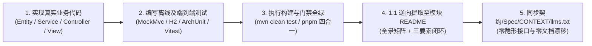

# 文档 1:1 保真与模块规范 (Documentation Specification)

> **作用域**：`ateng-solid` 根工作区、`ateng-solid-server`、`ateng-solid-admin-web` 及未来新增子仓。
> **唯一真源声明**：本规范主源维护于根仓库 `ateng-solid/docs/agents/documentation-specification.md`，由 `bash scripts/workspace.sh sync-rules` 单向同步至各子仓库；**与底座 `ateng-boot` / `ateng-cloud` / `ateng-ui` 的 `Sample-First` 同源，面向业务应用确立 `Code & Test-First` 1:1 逆向保真准则**。

---

## 1. 核心定位：Code & Test-First 1:1 逆向沉淀

在 `ateng-solid` 上层应用框架中，开发完成的每一个功能（自 `Spec 1` 起随编码推进）都必须**1:1 逆向沉淀**至对应文档，确保外部开发者与 AI 编程助手只读文档即可精准对接、二次开发与排查问题：



- **绝对前置工序**：编写或更新功能文档前，对应功能代码与测试用例**必须已经编译并通过本地全绿验证**。严禁凭空手敲未验证的接口路径、字段名、配置键或示例 JSON 响应。
- **阶段克制原则**：尚未启动编码的占位模块仅保留职责边界说明，禁止提前编造伪接口清单或测试桩输出充数。

---

## 2. 模块 `README.md` 应用五维骨架 (Application 5D Invariant)

后端核心实现与契约模块（`ateng-solid-{common,system-api,system,auth,bootstrap}/README.md`、二期 `ext-*`/`biz-*`）及前端应用工程（`ateng-solid-admin-web/README.md` / 独立特性模块 `src/modules/<feature>/README.md`）在其功能落地后，按以下 **五维结构** 1:1 沉淀：

````markdown
# <模块或应用名称> <中文全称>

> 一句话定位：阐明所属领域、对外路由前缀或前端职责与核心边界。

---

## 0. 对外契约与能力全景速查矩阵 (维度零：100% 全覆盖)

<!-- 后端模块示例表头（按模块类型裁剪列） -->
| 能力域 | 特性名称 | 核心类 / 端点 / SPI / 权限码 | 关键配置项 (`ateng.solid.*`) | 核心输入/输出与错误码 | 锚定验证测试 (`*Test.java`) |
| :--- | :--- | :--- | :--- | :--- | :--- |

<!-- 前端应用/特性模块示例表头 -->
| 功能域 | 页面 / 组件 / Store | 路由路径 (`path`) & 权限码 | 关联 API (`src/api/*`) | 复用的 `ateng-ui` 核心件 | 锚定单测 (`*.spec.ts`) |
| :--- | :--- | :--- | :--- | :--- | :--- |

## 1. 模块定位与依赖边界 (维度一：职责、模块依赖与快速启动/引入)

## 2. 核心架构与流转状态机 (架构图 / 数据表归属 / 权限或租户状态流转)

## 3. <业务能力领域大章一> (按业务域聚合收敛，严禁按迭代时间零碎追加)
### 3.1 <核心子功能 A> (配置 + 真实调用/代码 + 边界防御 三要素就近闭环)
### 3.2 <核心子功能 B>

## N-1. 扩展点 (SPI / Extension Slot) 与非功能边界 (维度二 & 三：插拔扩展、并发/事务/超时/安全防线)

## N. 完整配置清单与错误码附录 (全量速查字典)
````

### 五维强制规则
1. **维度零（100% 全景速查矩阵）**：
   - 模块暴露的全部 HTTP 端点、权限标识（`<域>:<资源>:<动作>`）、业务错误码、公共 `Remote*Service` 方法、扩展 SPI、`@ConfigurationProperties` 配置项及前端页面路由/Store/公共组件，**必须 100% 收录于第 0 节**，杜绝“代码写了但文档隐身”。
2. **章节“三要素就近闭环”红线**：
   - 每个功能小节必须在**当前屏幕内**同时给出：① 本节专属配置片段（YAML / Env，附中文注释与默认值）；② 1:1 提取自已通过测试的真实请求/响应报文或调用示例；③ 核心业务边界与异常/权限防御说明（如超管切换校验、空集合兜底、事务回滚或防爆破锁定阈值）。
3. **按能力领域大章聚合收敛**：
   - 同类能力归入同一一级大章（如 `用户与组织管理`、`角色与 @DataScope 数据权限`、`Excel 批注导入导出`），严禁按每次迭代 PR 顺序在末尾堆叠零碎小节。
4. **真实业务语义，清零测试桩噪声**：
   - 文档中的账号、租户、错误提示、请求示例必须采用真实企业级语义模型，严禁将单元测试里的 `"test_user_1"`、`"NORMAL_SUCCESS_"` 等临时测试桩原文照搬进 `README.md`。

---

## 3. 跨端 Specs、`CONTEXT.md` 与 `llms.txt` 协同规范

| 文档载体 | 更新时机与职责 | 核心禁忌 |
| :--- | :--- | :--- |
| **`docs/specs/*.md`**（跨端与端内规格） | 新增/修改接口路径、请求/响应字段、错误码段、数据库表/Flyway、前端视图路由或 Store 时**同窗口同步更新** | 严禁代码已改字段但 Spec 仍保留旧字段名 |
| **各子模块 `CONTEXT.md`** | 确立新业务领域概念、核心状态或禁用词（`_Avoid_`）时立即内联更新；跨模块拓扑变化同步更新 `CONTEXT-MAP.md` | 严格恪守纯词汇表定位，不堆砌实现代码或配置 |
| **`docs/adr/`** | 仅当出现难逆转、存在真实权衡且缺上下文难以理解的重大架构决策时新增；常规演进优先修订存量 ADR 并同步更新索引 | 严禁为常规 CRUD 或微调刷无意义 ADR |
| **根目录与子仓 `llms.txt`** | 遵循 [llmstxt.org](https://llmstxt.org/) 分组格式，索引全局治理、Specs、ADR 与全部核心模块的 `README.md`/`CONTEXT.md` | **纯相对路径（`./...`）**；**严禁硬编码具体版本号**（引导 AI 从 `pom.xml`/`package.json` 获取真源） |

---

## 4. Markdown 排版防裂守卫 (Markdown Integrity Guard)

1. **表格管道符与泛型防护**：Markdown 表格单元格内凡出现泛型（如 `` `Result<T>` ``、`` `TenantAware<Long>` ``）或管道符（`|`），必须使用反引号包裹或转义为 `\|`，防止表格列错位。
2. **代码块反引号阶梯**：外层代码块包裹内层代码块时，外层必须使用四反引号（```` ````markdown ````）包裹内层三反引号（```` ```yaml ````），确保开闭成对。
3. **纯相对路径互链**：仓内所有 Markdown 文件（含 `README.md`、`llms.txt`、`CONTEXT.md`、`docs/`）相互引用**100% 使用相对路径**（`./`、`../`），**严禁写入 `file:///` 协议或本地盘符绝对路径（`C:/`、`D:/`）**。

---

## 5. 📋 1:1 文档保真与成熟度 10 项准出自检清单

在每次特性开发完成、提交前自检或执行 `/code-review` 时，必须逐项核验以下 **10 项卡点**（纯文档勘误仅核验第 4、5、6、7、8 项）：

- [ ] **1. Code & Test-First 前置全绿**：文档覆盖的所有新功能、接口与配置，是否已在本地通过全部编译、单测/集成测试与架构守卫（`mvn clean test` / `pnpm 四合一`）？
- [ ] **2. 1:1 真实源码与报文提取**：文档中的 HTTP 路径、DTO/VO 字段、YAML/Env 键名、错误码与响应示例，是否 100% 源自已通过测试的真实代码与输出（无脑补字段或虚构报文）？
- [ ] **3. 维度零 100% 全景覆盖**：模块新增/变更的全部对外端点、权限标识、错误码、`Remote*Service`、SPI、配置项与前端路由/Store，是否全部收录于对应模块 `README.md` 第 0 节全景速查矩阵？
- [ ] **4. 能力大章收敛与三要素闭环**：同类特性是否已归并至对应能力域大章，且每个小节在同一屏幕内闭环展示“专属配置 + 真实调用/代码 + 边界防御”三要素？
- [ ] **5. 真实业务语义去噪**：文档示例是否已剔除测试桩占位、冗余断言噪声与无意义示例数据？
- [ ] **6. 跨端 Specs 与契约零漂移**：接口/字段/错误码/DDL/路由变更是否已同步更新 `docs/specs/*.md`（及涉及跨端协议时的根仓 `contracts.md` + `sync-rules`）？
- [ ] **7. `CONTEXT` / `ADR` / `llms.txt` 同步**：新领域术语与 `_Avoid_` 词表是否内联更新至 `CONTEXT.md`？新增模块/重要文档入口是否已收录进 `llms.txt`（且 `llms.txt` 无硬编码版本号）？
- [ ] **8. 排版防裂与纯相对路径**：表格泛型/管道符是否正确转义、多层代码块是否使用四反引号、全部内部链接是否采用相对路径且无死链与本地盘符路径？
- [ ] **9. 双模安全与零明文凭据**：示例配置与文档中是否全部采用大写语义占位符（如 `YOUR_DB_PASSWORD`），100% 杜绝真实连接串、Token 或默认弱口令哈希泄露？
- [ ] **10. 架构与编码红线对齐**：源码是否同时满足本仓 [`AGENTS.md`](../../AGENTS.md)、[`contracts.md`](./contracts.md) 与 [`coding-standards.md`](./coding-standards.md) 中的分层边界、大类拆解、注释规范、零 Entity 泄漏与多租户安全红线？
